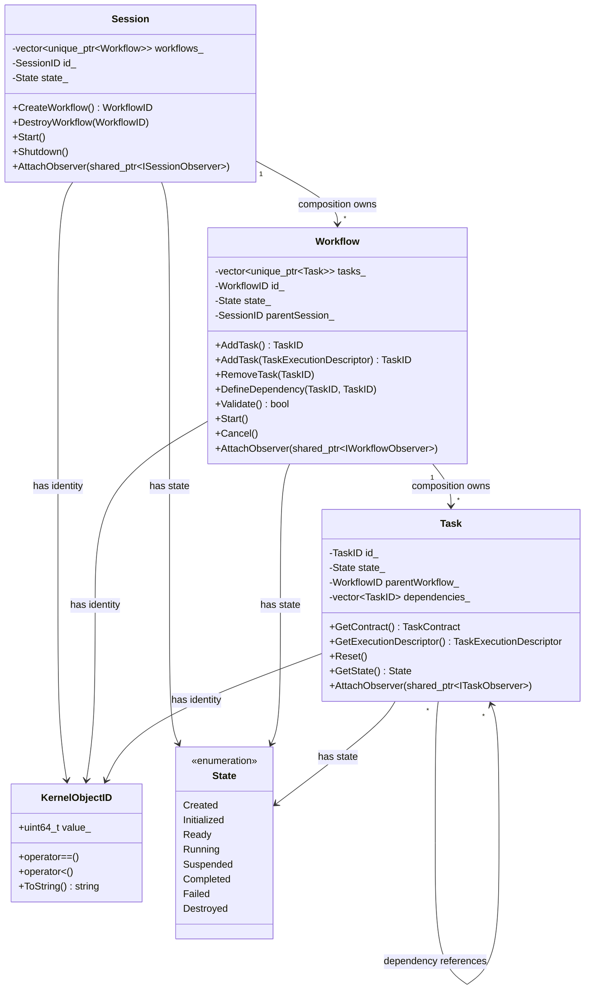
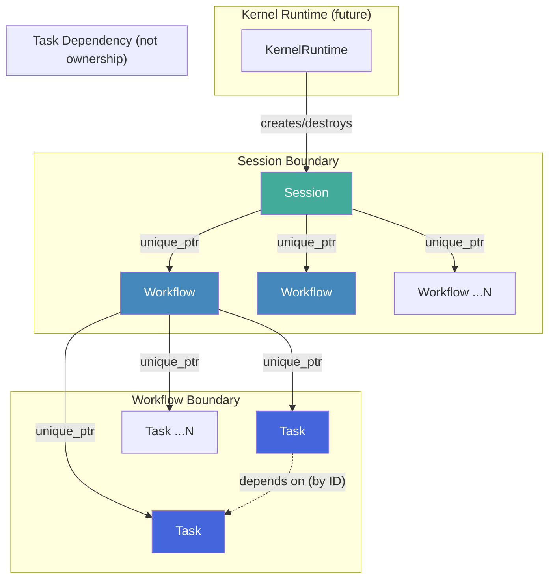
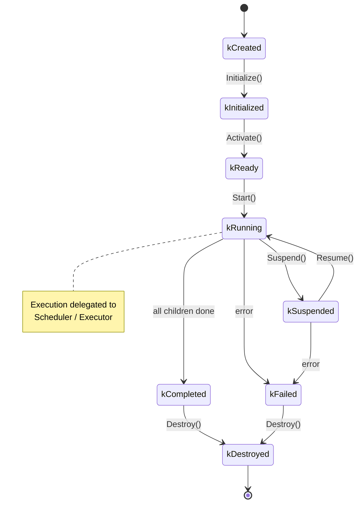
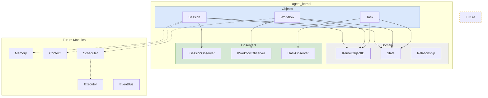

# AK0011 �Kernel Domain Model Specification

**Status:** Frozen  
**Version:** 1.0  
**Phase:** AVP-1 Core Foundation Prototype  
**Supersedes:** None  
**Obsoletes:** None  

---

## Chapter 1 �Scope and Purpose

### 1.1 Scope

This document defines the Kernel Domain Model for Agent Kernel. It specifies:

- The three first-class Kernel Objects: **Session**, **Workflow**, **Task**
- Their responsibilities, relationships, and ownership rules
- The unified identity system (`KernelObjectID`)
- The unified lifecycle state model
- Dependency rules governing inter-object communication
- Architecture principles and future extension points

Objects explicitly deferred to later specifications:

| Object | Appears In |
|--------|-----------|
| Memory | AK0020+ |
| Context | AK0020+ |
| Scheduler | AK0030+ |
| Executor | AK0030+ |
| EventBus | AK0040+ |
| Plugin System | AK0050+ |
| Kernel Runtime | AK0060+ |
| Kernel API | AK0070+ |

### 1.2 Purpose

The Kernel Domain Model is the **immutable conceptual foundation** of Agent Kernel. Every line of runtime code, every plugin, every integration point must conform to the relationships and responsibilities defined here. Changing this document requires a new AK specification and full cross-module impact analysis.

### 1.3 Audience

| Role | How This Document Is Used |
|------|--------------------------|
| C++ Architect | Reference for all downstream interface design |
| Codex | Instruction source for Session/Workflow/Task implementation |
| GPT-5.5 / DeepSeek | Context for architecture review and code generation |
| Plugin Developer | Contract for what Kernel Objects provide |

---

## Chapter 2 �Architecture Principles

### 2.1 Principle Table

| # | Principle | How Reflected in Domain Model |
|---|-----------|-------------------------------|
| 1 | **High Cohesion** | Each Kernel Object owns all data and behavior for its responsibility. Session owns lifecycle. Workflow owns orchestration. Task describes execution intent. |
| 2 | **Low Coupling** | Objects communicate through well-defined observer interfaces, not direct access. Task never touches Session internals. |
| 3 | **Dependency Inversion** | Higher-level objects depend on abstractions (interfaces), not concretions. Session depends on `IWorkflowObserver`, not `Workflow` directly. |
| 4 | **Composition over Inheritance** | Relationships are composition (Session contains Workflow) or association (Task references Context). No deep inheritance hierarchies. |
| 5 | **Single Responsibility** | One reason to change per Kernel Object. Session changes when execution scope rules change. Workflow changes when orchestration rules change. |
| 6 | **Explicit Ownership** | Every Kernel Object has exactly one owner. Ownership is expressed in the type system (unique_ptr). No shared mutable ownership. |
| 7 | **Immutable Identity** | `KernelObjectID` is assigned at creation and never changes. Identity is independent of object state or location. |
| 8 | **Future Concurrency** | State models are designed for concurrent access from the start. Every state transition is a candidate for synchronization. |
| 9 | **Future Plugin Support** | Kernel Objects expose observer interfaces. Plugins attach through these interfaces without modifying Kernel Objects. |
| 10 | **Future Distributed Execution** | `KernelObjectID` is designed with distributed uniqueness. Object relationships can span process boundaries. |

---

## Chapter 3 �Kernel Object Catalog

### 3.1 Object Overview

```
+-----------------------------------------------------------+
|                      Kernel Objects                        |
|                                                           |
|   +---------+     +----------+     +------+               |
|   | Session |---->| Workflow |---->| Task |               |
|   | (owns)  |     | (owns)   |     |      |               |
|   +---------+     +----------+     +------+               |
|        |               |               |                  |
|        |               |               +-- Execution Description |
|        |               +-- Orchestration                  |
|        +-- Execution Scope                                 |
+-----------------------------------------------------------+
```

### 3.2 Session

**Purpose**

A Session represents one isolated execution environment. It owns the entire lifecycle of a logical execution: from creation through initialization, execution of workflows, to teardown.

**Responsibilities**

| Responsibility | Details |
|----------------|---------|
| Own Workflows | Session creates and destroys all Workflow instances within its scope |
| Provide Execution Scope | Defines the boundary within which Workflows and Tasks execute |
| Own Lifecycle | Controls the Session state machine (kCreated -> kInitialized -> kReady -> kRunning -> kCompleted -> kDestroyed) |
| Expose Observability | Provides `ISessionObserver` interface for external monitoring |
| Resource Container | Will own Memory and Context instances in future specifications |

**Lifetime**

| Phase | Creator | Destroyer |
|-------|---------|-----------|
| Session | Created by Kernel Runtime | Destroyed by Kernel Runtime |
| Workflows | Created by Session | Destroyed by Session |

**Owner**

| Owner | Relationship |
|-------|-------------|
| Kernel Runtime | Owns Session via `std::unique_ptr<Session>` |
| **No parent** | Session is the top-level Kernel Object |

**Children**

| Child | Relationship | Multiplicity |
|-------|-------------|--------------|
| Workflow | Composition (Session owns Workflow) | 0..N |

**State**

Session progresses through these states:

```
kCreated -> kInitialized -> kReady -> kRunning -> kCompleted -> kDestroyed
                                |
                                +-> kFailed (from any active state)
```

**Allowed Operations**

| Operation | Constraint |
|-----------|------------|
| Create Session | Via SessionBuilder |
| Create Workflow | Via WorkflowRegistry |
| Destroy Workflow | By WorkflowID |
| Attach Observer | Observer pattern |
| Query state | Read-only via GetState() |

**Forbidden Operations**

- Execute Task directly (delegated to future Scheduler/Executor �belongs to Runtime)
- Access Memory directly (delegated to Memory module)
- Access Context directly (delegated to Context module)
- Modify Workflow internals

**Future Extensions**

- Resource quotas per Session
- Session-level Memory isolation
- Session migration for distributed execution
- Session checkpoint/restore

---

### 3.3 Workflow

**Purpose**

A Workflow represents one executable orchestration. It owns a directed acyclic graph (DAG) of Tasks and is responsible for its lifecycle, validation, and state management.

**Responsibilities**

| Responsibility | Details |
|----------------|---------|
| Own Tasks | Workflow creates and destroys all Task instances within its graph |
| Define Topology | Declares the dependency structure between its Tasks |
| Validate Graph | Operation performed during initialization (not a lifecycle state) |
| Own Lifecycle | Controls the Workflow state machine |
| Expose Observability | Provides `IWorkflowObserver` interface |

**Lifetime**

| Phase | Creator | Destroyer |
|-------|---------|-----------|
| Workflow | Created by Session (via CreateWorkflow) | Destroyed by Session |
| Tasks | Created by Workflow | Destroyed by Workflow |

**Owner**

| Owner | Relationship |
|-------|-------------|
| Session | Owns Workflow via `std::unique_ptr<Workflow>` |

**Parent**

| Parent | Relationship |
|--------|-------------|
| Session | Composition parent |

**Children**

| Child | Relationship | Multiplicity |
|-------|-------------|--------------|
| Task | Composition (Workflow owns Task) | 1..N |

**State**

```
kCreated -> kInitialized -> kReady -> kRunning -> kCompleted
                                              |           |
                                              +-> kFailed   +-> kDestroyed
```

**Allowed Operations**

| Operation | Constraint |
|-----------|------------|
| Add Task | Via TaskRegistry |
| Remove Task | By TaskID |
| Define dependency | Via DefineDependency() |
| Validate graph | Delegated to WorkflowGraph |
| Attach Observer | Observer pattern |
| Query state | Read-only via GetState() |
| Query Task | Via FindTask() |

**Forbidden Operations**

- Execute Task directly (delegated to future Scheduler/Executor)
- Access Session internals
- Modify running Task state
- Create circular dependencies

**Future Extensions**

- Dynamic graph modification during execution
- Sub-workflow composition
- Retry policies at Workflow level
- Parallel branch execution strategies

---

### 3.4 Task

**Purpose**

A Task represents one atomic execution description within a Workflow. It is the smallest schedulable entity in the Kernel. Task describes *what* to execute, not *how* to execute it.

**Responsibilities**

| Responsibility | Details |
|----------------|---------|
| Describe Execution Intent | Owns TaskExecutionDescriptor (capability, version, hints) |
| Own Lifecycle | Controls the Task state machine (KernelObjectState) |
| Report Completion | Signals success/failure to observers |
| Hold Dependency Metadata | Read-only TaskID references; authoritative topology in WorkflowGraph |

**Lifetime**

| Phase | Creator | Destroyer |
|-------|---------|-----------|
| Task | Created by Workflow (via AddTask) | Destroyed by Workflow |
| Result | Produced by future Runtime execution layer | Managed by Runtime; accessible via observer |

**Owner**

| Owner | Relationship |
|-------|-------------|
| Workflow | Owns Task via `std::unique_ptr<Task>` |

**Parent**

| Parent | Relationship |
|--------|-------------|
| Workflow | Composition parent |

**Children**

None. Task is a leaf object.

**State**

```
kCreated -> kInitialized -> kReady -> kRunning -> kCompleted
                                           |              |
                                           +-> kFailed    +-> kDestroyed
```

**Allowed Operations**

| Operation | Constraint |
|-----------|------------|
| Read dependency metadata | Dependencies are descriptive metadata only |


- Read dependency metadata (via GetDependencies())
- Query state (via GetState())
- Query identity (via GetID())
- Read contract (via GetContract())
- Read execution descriptor (via GetExecutionDescriptor())
- Reset (preserves identity, contract, and descriptor)

**Forbidden Operations**

- Access Workflow internals
- Access Session
- Access other Tasks directly
- Modify its own dependencies during execution
- Spawn child Tasks (use Workflow.AddTask)

**Future Extensions**

- Retry policies (per-Task)
- Timeout configuration
- Streaming output
- Checkpoint/resume

---

## Chapter 4 �Object Relationships

### 4.1 Relationship Table

| Source | Target | Type | Multiplicity | Cardinality | Description |
|--------|--------|------|--------------|-------------|-------------|
| Session | Workflow | Composition | 0..N | Session owns Workflow. Workflow cannot exist without Session. |
| Workflow | Task | Composition | 1..N | Workflow owns Task. Task cannot exist without Workflow. |
| Task | Task | Dependency | 0..N | Task A depends on Task B (A waits for B). Not ownership. |
| Session | KernelObjectID | Association | 1 | Session has an identity. |
| Workflow | KernelObjectID | Association | 1 | Workflow has an identity. |
| Task | KernelObjectID | Association | 1 | Task has an identity. |
| Session | ISessionObserver | Association | 0..N | Observers attached to Session. |
| Workflow | IWorkflowObserver | Association | 0..N | Observers attached to Workflow. |
| Task | ITaskObserver | Association | 0..N | Observers attached to Task. |

### 4.2 Relationship Type Definitions

| Type | Semantics | C++ Representation |
|------|-----------|-------------------|
| **Composition** | Child lifetime bound to parent. Parent creates and destroys child. | `std::unique_ptr<T>` member |
| **Dependency** | Task A references Task B by ID. Not ownership. | `KernelObjectID` member |
| **Association** | Non-owning reference to an observer or service. | Interface pointer/reference |

### 4.3 Ownership Rules

1. **Session owns Workflow.** When Session is destroyed, all its Workflows are destroyed. No external code holds a `unique_ptr` to a Workflow.
2. **Workflow owns Task.** When Workflow is destroyed, all its Tasks are destroyed. No external code holds a `unique_ptr` to a Task.
3. **No cross-parent ownership.** A Workflow in Session A cannot own Tasks that belong to a Workflow in Session B.
4. **No shared mutable ownership.** `shared_ptr` is forbidden for Kernel Objects. Observers use raw pointers or weak pointers with documented lifetime.
5. **Dependency is reference, not ownership.** Task A depending on Task B does not affect B's lifetime. B is still destroyed when its Workflow is destroyed.

---

## Chapter 5 �Identity System

### 5.1 KernelObjectID Design

| Requirement | Implementation Decision |
|-------------|------------------------|
| Globally unique within one Session | 64-bit unsigned integer, monotonically increasing |
| Stable during lifetime | Immutable after construction |
| Comparable | `operator<`, `operator==`, `operator<=>` |
| Serializable | String representation, hashable |
| Printable | `operator<<` for ostream |
| Future distributed | Reserved type tag for UUID-based extension |

### 5.2 Type Hierarchy for Identity

```
KernelObjectID (base, value type)
    |
    +-- SessionID
    +-- WorkflowID
    +-- TaskID
```

Each typed ID is a separate type (not a typedef) to prevent accidental cross-type assignment (e.g., passing a TaskID where a WorkflowID is expected). All typed IDs share the same internal representation and comparison semantics.

---

## Chapter 6 �State Model

### 6.1 Common Kernel Object State

Every Kernel Object follows the same conceptual lifecycle:

```
                     +-----------+
                     |  kCreated  |
                     +-----+-----+
                           |
                     +-----v-----+
                     | kInitialized|
                     +-----+-----+
                           |
                     +-----v-----+
                     |  kReady   |
                     +-----+-----+
                           |
              +-----------+-----------+
              |                       |
        +-----v-----+          +-----v-----+
        |  kRunning   |          | kSuspended |
        +-----+-----+          +-----+-----+
              |                       |
              +-----------+-----------+
                          |
                    +-----v-----+
                    | kCompleted |
                    +-----+-----+
                          |
                    +-----v-----+
                    | kDestroyed |
                    +-----------+

                  (any active state)
                          |
                    +-----v-----+
                    | kFailed   |
                    +-----+-----+
                          |
                    +-----v-----+
                   | kDestroyed ||
                    +-----------+
```

### 6.2 State Transition Table

| From | To | Trigger | Condition |
|------|----|---------|-----------|
| kCreated | kInitialized | `Initialize()` called | Valid configuration provided |
| kInitialized | kReady | `Validate()` passed | All dependencies present |
| kReady | kRunning | `Start()` called | Scheduler/Executor available |
| kRunning | kCompleted | All child objects completed | No errors |
| kRunning | kSuspended | `Suspend()` called | Implementation supports suspension |
| kSuspended | kRunning | `Resume()` called | Implementation supports resumption |
| kRunning | kFailed | Child object failed | Irrecoverable error |
| kSuspended | kFailed | Irrecoverable error during suspension | - |
| kCompleted | kDestroyed | `Destroy()` called | Resources released |
| kFailed | kDestroyed | `Destroy()` called | Resources released |

### 6.3 State Rules

1. All states are observable via `GetState()`.
2. Illegal transitions throw `ak::StateError`.
3. `Destroyed` is terminal �no transition out.
4. `Failed` is terminal per object instance �the only transition out is `Destroyed`.
5. `Suspended` �`Destroyed` is always allowed (abort).

---

## Chapter 7 �Lifecycle Protocol

### 7.1 Creation

```
[Creator]                          [Factory]
    |                                  |
    |-- KernelObjectFactory::Create -->|
    |                                  |-- Assign KernelObjectID
    |                                  |-- Validate parameters
    |                                  |-- Construct object (kCreated state)
    |<-- return unique_ptr ------------|
    |                                  |
```

- Session is created by Kernel Runtime (future).
- Workflow is created by Session via a factory method.
- Task is created by Workflow via a factory method.

### 7.2 Initialization

```
[Owner]                            [KernelObject]
   |                                     |
   |-- object->Initialize(params) ------>|
   |                                     |-- Validate params
   |                                     |-- Allocate resources
   |                                     |-- Transition to Initialized
   |<-- return Result -------------------|
```

### 7.3 Activation

```
[Owner]                            [KernelObject]
   |                                     |
   |-- object->Activate() -------------->|
   |                                     |-- Validate ready
   |                                     |-- Transition to Ready
   |<-- return Result -------------------|
```

### 7.4 Execution

Execution is NOT performed by the Kernel Object itself. Execution is delegated:

```
Session --[start]--> Workflow --[submit]--> Scheduler --[dispatch]--> Executor --[execute]--> Task
```

The Domain Model defines only the interface contract. The actual dispatch belongs to the Scheduler/Executor specification (AK0030+).

### 7.5 Completion

```
Task --[OnkCompleted]--> WorkflowObserver --[Notify]--> Workflow --[CheckGraph]--> ...
Task --[OnkFailed]-----> WorkflowObserver --[Notify]--> Workflow --[Propagate]--> Session
```

### 7.6 Destruction

```
[Owner]                            [KernelObject]
   |                                     |
   |-- object->Destroy() --------------->|
   |                                     |-- Cancel if Running
   |                                     |-- Release resources
   |                                     |-- Transition to Destroyed
   |-- unique_ptr destructor fires ----->|
   |                                     |-- ~KernelObject()
```

Rules:

1. Only the Owner destroys the Kernel Object.
2. `Destroy()` is a graceful shutdown.
3. The `unique_ptr` destructor is the final release.
4. No garbage collection �destruction is explicit.

---

## Chapter 8 �Dependency Rules

### 8.1 Dependency Direction

```
Kernel Runtime (future)
    |
    v
Session
    |
    v
Workflow
    |
    v
Task
    |
    v
(no lower-level Kernel Objects �Task is leaf)
```

### 8.2 Dependency Table

| Kernel Object | May Depend On | Must NOT Depend On |
|---------------|---------------|---------------------|
| Session | ISessionObserver, KernelObjectID, State | Workflow internals, Task internals, Scheduler, Executor, Memory, Context |
| Workflow | IWorkflowObserver, KernelObjectID, State, TaskID | Session internals, Scheduler, Executor, Memory, Context |
| Task | ITaskObserver, KernelObjectID, State | Workflow internals, Session internals, Other Task internals, Scheduler, Executor |

### 8.3 Dependency Rules

1. **Downward-only dependencies.** Higher-level objects depend on abstractions of lower-level objects, never on their internals.
2. **No circular dependencies.** The dependency graph is a DAG. This is enforced at compile time via `target_link_libraries`.
3. **Interface isolation.** Cross-object communication goes through observer interfaces (`ISessionObserver`, `IWorkflowObserver`, `ITaskObserver`), never through direct member access.
4. **Scheduler/Executor are separate modules.** Session and Workflow submit work through defined interfaces. They do not execute anything themselves.
5. **Memory and Context are not yet in the graph.** When added, they will be injected as services, not inherited or composed.

---

## Chapter 9 �Observer Interfaces

### 9.1 Purpose

Observer interfaces decouple Kernel Objects from their consumers. Any component �internal module, plugin, or external system �can attach to observe state changes without modifying the observed object.

### 9.2 Defined Observers

| Observer | Observed Object | Notification Events |
|----------|----------------|---------------------|
| ISessionObserver | Session | OnStateChanged, OnWorkflowCreated, OnWorkflowDestroyed, OnError |
| IWorkflowObserver | Workflow | OnStateChanged, OnTaskCreated, OnTaskCompleted, OnTaskFailed, OnError |
| ITaskObserver | Task | OnStateChanged, OnCompleted, OnFailed, OnProgress |

### 9.3 Observer Rules

1. Observers are attached via `AttachObserver(std::shared_ptr<IObserver>)`.
2. Observers are detached via `DetachObserver(IObserver*)`.
3. Observer callbacks must not throw.
4. Observer callbacks must not block (future async requirement).
5. Observers do not extend object lifetime (weak ownership).

---

## Chapter 10 �Future Integration Points

### 10.1 Memory Integration (AK0020+)

Memory will be associated with Session. The Session will provide Memory access to its Workflows and Tasks through dependency injection. Integration point:

```cpp
class Session {
    // Future
    void SetMemory(std::unique_ptr<Memory> memory);
    Memory& GetMemory();
};
```

### 10.2 Context Integration (AK0020+)

Context will flow through the execution hierarchy. Session creates the root Context. Workflow creates scoped sub-contexts. Task receives its Context at execution time. Integration point:

```cpp
class Workflow {
    // Future
    void SetContext(std::shared_ptr<Context> context);
};
```

### 10.3 Scheduler/Executor Integration (AK0030+)

Session submits Workflow to Scheduler. Scheduler dispatches Tasks to Executor. Integration point:

```cpp
class Session {
    // Future
    void SetScheduler(IScheduler& scheduler);
};

class Workflow {
    // Future
    void Submit(IScheduler& scheduler);
};
```

### 10.4 EventBus Integration (AK0040+)

Observer interfaces will be bridged to EventBus forè·?component event distribution.

### 10.5 Plugin Integration (AK0050+)

Observer interfaces are the natural attachment point for plugins. A plugin implements an observer interface and attaches to the relevant Kernel Object.

---

## Chapter 11 �Mermaid Diagrams

### 11.1 Object Relationship Diagram



### 11.2 Ownership Diagram



### 11.3 Lifecycle Diagram



### 11.4 Package Diagram



---

## Chapter 12 �C++ Interface Conventions

All interface skeletons in `include/agent_kernel/` follow these conventions:

| Convention | Rule |
|------------|------|
| Namespace | `namespace ak {` |
| Include guard | `#pragma once` |
| No implementation | Headers declare only. No `.cpp` files in this specification. |
| No inline code | No function bodies in headers. |
| No TODO comments | Not allowed. Incomplete interfaces are marked `// Reserved for future specification`. |
| No runtime behavior | No algorithms, no business logic, no state machine execution. |
| Ownership | `std::unique_ptr` for exclusive ownership. `std::shared_ptr` only for observer attachments. |
| `noexcept` | Destructors, getters, and observers are `noexcept`. |
| `[[nodiscard]]` | All query methods returning values. |

---

*End of AK0011 �Kernel Domain Model Specification*
