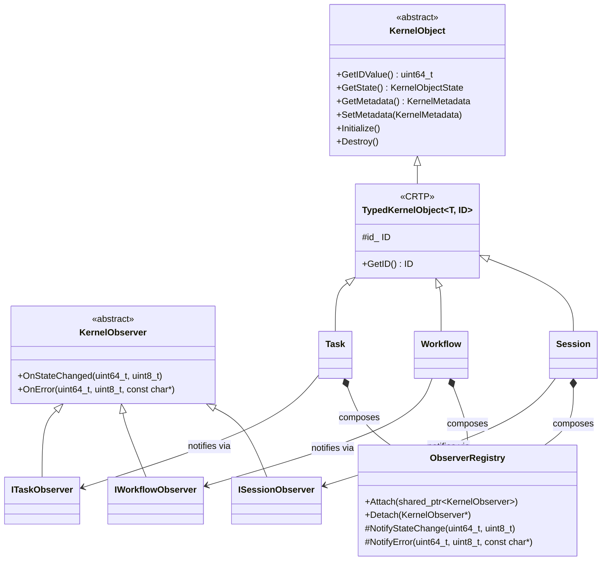
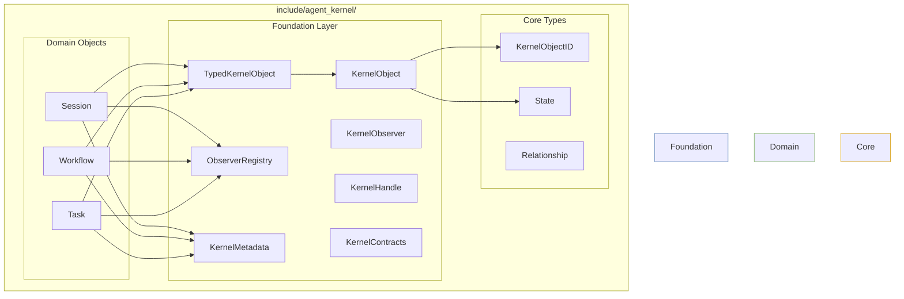
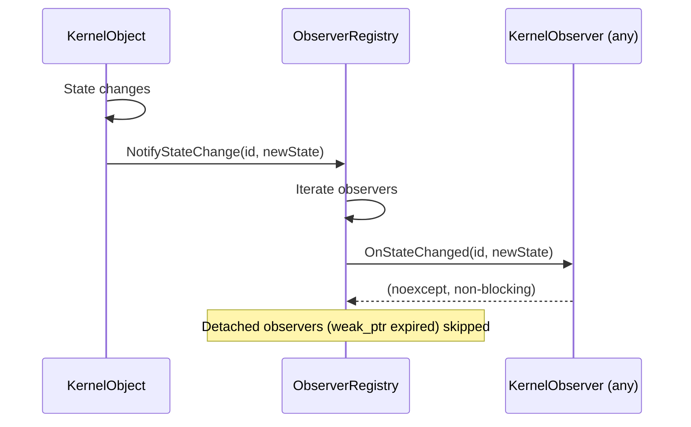

# AK0012 �Kernel Foundation Layer

**Status:** Frozen  
**Version:** 1.0  
**Phase:** AVP-1 Core Foundation Prototype  
**Supersedes:** None  
**Replaces:** No AK document �this is a consolidation of AK0011 interfaces  

---

## Chapter 1 �Purpose

### 1.1 Why the Foundation Layer Exists

AK0011 defined the Kernel Domain Model: Session, Workflow, Task, their relationships, identity, and lifecycle. The interface skeletons produced by AK0011 contained significant duplication:

| Duplicated Pattern | Appears In | Occurrences |
|-------------------|------------|-------------|
| `GetID()` + private `id_` field | Session, Workflow, Task | 3 |
| `GetState()` + private `state_` field | Session, Workflow, Task | 3 |
| `AttachObserver()` / `DetachObserver()` | Session, Workflow, Task | 3 |
| Observer interface definition (`OnStateChanged`, `OnError`) | ISessionObserver, IWorkflowObserver, ITaskObserver | 3 |
| Class scaffolding (deleted copy, noexcept move, etc.) | Session, Workflow, Task | 3 |
| Metadata support (name, label, description) | None �did not exist | 0 |

The Foundation Layer extracts these common patterns into reusable abstractions while preserving the AK0011 Domain Model intact.

### 1.2 Why It Was Introduced After AK0011

The separation of concerns is intentional:

1. **AK0011** establishes *what* exists (the Domain Model �objects, relationships, ownership)
2. **AK0012** establishes *how* objects express their common nature (the Foundation Layer �shared contracts, identity access, observation machinery)

This ordering ensures the Domain Model is validated before extracting shared infrastructure. Premature extraction would have risked abstractions that don't match the actual object relationships.

### 1.3 Relationship to AK0011

```
AK0011 (Domain Model)                 AK0012 (Foundation Layer)
                                                                 
Session ──────────────────────────�                               
                                  ├── inherits ──�                
Workflow ────────────────────────�              �                
                                  ├── inherits ──�                
Task ─────────────────────────────�              �                
                                                  ├── KernelObject (abstract)
Memory (future) ─────────────────�               �  (identity + state + lifecycle)
                                 ├── inherits ────�                
Context (future) ────────────────�                                 
                                                                    
All Kernel Objects ────────────── composes ── KernelMetadata        
All Kernel Objects ────────────── composes ── ObserverRegistry      
All Kernel Objects ────────────── satisfy ─── KernelContracts       
Future ────────────────────────── uses ────── KernelHandle          
```

---

## Chapter 2 �Foundation Components

### 2.1 Component Overview

```
include/agent_kernel/foundation/
├── kernel_object.hpp        # Abstract base (TypedKernelObject CRTP)
├── kernel_metadata.hpp      # Descriptive info (name, label, tags, timestamps)
├── kernel_observer.hpp      # Observer base + ObserverRegistry mix-in
├── kernel_handle.hpp        # Lightweight stable reference (template)
└── kernel_contracts.hpp     # Behavioral contracts + static assertions
```

### 2.2 KernelObject (`kernel_object.hpp`)

**Purpose:** Abstract base interface shared by all Kernel Objects.

**Design decisions:**

| Decision | Rationale |
|----------|-----------|
| Abstract base (not concrete) | Each object manages its own state machine and child objects. A concrete base would force a specific state storage strategy. |
| `TypedKernelObject<T, ID>` CRTP | Provides type-safe `GetID()` without virtual dispatch. The CRTP pattern avoids runtime overhead on the most-called method. |
| Inheritance for identity only | The Domain Model (AK0011) is not inheritance-heavy. Only the identity/state contract is inherited. All other commonality is composed. |

**What is NOT in KernelObject:**

- `Activate()` �not all objects have it (Task doesn't)
- `Start()` / `Cancel()` �Workflow-specific
- `CreateWorkflow()` �Session-specific
- `DefineDependency()` �Workflow-specific
- Status callbacks �domain-specific observer events

This ensures KernelObject remains the minimal common contract.

### 2.3 KernelMetadata (`kernel_metadata.hpp`)

**Purpose:** Common descriptive information for every Kernel Object.

**Fields:**

| Field | Type | Mutable | Purpose |
|-------|------|---------|---------|
| `name` | `std::string` | Yes | Human-readable identifier (e.g., "Session-42") |
| `label` | `std::string` | Yes | Short display label |
| `description` | `std::string` | Yes | Optional detailed description |
| `tags` | `std::vector<std::string>` | Yes | Categorization tags |
| `creationTime` | `time_point` | No (set once) | Creation timestamp |
| `properties` (future) | key-value map | Yes | Extensible property bag |

**Why metadata is separate from identity:**

`KernelObjectID` is immutable and serves as the object's stable key. `KernelMetadata` is mutable and serves discovery/display purposes. Mixing them would conflate identity with presentation.

### 2.4 KernelObserver (`kernel_observer.hpp`)

**Purpose:** Eliminate duplicated observer definitions and registration code.

**Before Foundation Layer:**

Each object had:
- Its own observer interface with `OnStateChanged` and `OnError` duplicated
- Its own `AttachObserver` / `DetachObserver` implementation
- Its own observer storage (vector of shared_ptr)

**After Foundation Layer:**

- `KernelObserver` provides `OnStateChanged` and `OnError` once
- `ObserverRegistry` provides `Attach()`, `Detach()`, and notification dispatch
- Each typed observer (`ISessionObserver`, etc.) adds only domain-specific events

| Object | Observers Before | Observers After | Reduction |
|--------|-----------------|-----------------|-----------|
| Session | 4 events in ISessionObserver | 2 domain-specific + 2 inherited | 2 eliminated |
| Workflow | 5 events in IWorkflowObserver | 3 domain-specific + 2 inherited | 2 eliminated |
| Task | 4 events in ITaskObserver | 3 domain-specific + 2 inherited | 2 eliminated |

### 2.5 KernelHandle (`kernel_handle.hpp`)

**Purpose:** Lightweight, stable, non-owning reference to a Kernel Object.

**Properties:**

| Property | Value |
|----------|-------|
| Ownership | Non-owning (does not extend lifetime) |
| Copyable | Yes (value type) |
| Comparable | Yes (full comparison via `<=>`) |
| Hashable | Yes (`std::hash` specialization) |
| Serializable | Reserved for future (distributed execution) |
| Stale detection | Generation counter (increment on each re-creation of an ID) |

**Why not raw pointer?**

| Aspect | Raw Pointer | KernelHandle |
|--------|-------------|-------------|
| Type safety | No (void* or base*) | Yes (template parameter) |
| Stale detection | No | Yes (generation counter) |
| Distributed support | No | Yes (future addressing fields) |
| Copy semantics | Shallow | Value type with comparison |

**Why not shared_ptr?**

| Aspect | shared_ptr | KernelHandle |
|--------|------------|-------------|
| Lifetime extension | Yes (prevents destruction) | No (observer semantics) |
| Atomic refcount | Yes (overhead) | No (value type) |
| Distributed support | No | Yes (future) |

### 2.6 KernelContracts (`kernel_contracts.hpp`)

**Purpose:** Document behavioral contracts as code.

Contains:
- `LifecycleContract` �documented conventions for creation/initialization/destruction
- `ObservableContract` �documented conventions for observer attachment
- `OwnershipContract` �documented ownership rules (cross-references relationship.hpp)
- `IdentityContract` �`is_kernel_object_id<T>` trait + `AssertValidIdentity<T>()`

---

## Chapter 3 �Refactoring Summary

### 3.1 Changes to Session

| Aspect | Before (AK0011) | After (AK0012) |
|--------|----------------|----------------|
| Base class | None | `TypedKernelObject<Session, SessionID>` |
| `GetID()` | Declared explicitly | Inherited from CRTP |
| `GetIDValue()` | Not present | Inherited from KernelObject |
| `id_` member | Declared privately | Inherited from CRTP |
| `GetMetadata()` | Not present | New (KernelObject override) |
| `SetMetadata()` | Not present | New (KernelObject override) |
| `metadata_` member | Not present | New (composed) |
| `AttachObserver` | Self-implemented | Delegates to `observerRegistry_` |
| `DetachObserver` | Self-implemented | Delegates to `observerRegistry_` |
| `observerRegistry_` | Not present | New (composed) |
| `ISessionObserver` | Standalone | Inherits `KernelObserver` |

**Public API preserved:** Yes. No method removed or renamed.

### 3.2 Changes to Workflow

Identical pattern to Session: inherits `TypedKernelObject<Workflow, WorkflowID>`, composes `ObserverRegistry` + `KernelMetadata`.

**Public API preserved:** Yes.

### 3.3 Changes to Task

Identical pattern to Session and Workflow: inherits `TypedKernelObject<Task, TaskID>`, composes `ObserverRegistry` + `KernelMetadata`.

**Public API preserved:** Yes.

### 3.4 Code Duplication Eliminated

| Pattern | Previously Defined | Now Defined | Duplication Eliminated |
|---------|-------------------|-------------|------------------------|
| ID access + storage | 3× (Session, Workflow, Task) | 1× (TypedKernelObject) | 2× |
| Observer attach/detach | 3× | 1× (ObserverRegistry) | 2× |
| Observer base (OnStateChanged, OnError) | 3× | 1× (KernelObserver) | 2× |
| Metadata support | 0× | 1× (KernelMetadata) | New capability |
| Handle abstraction | 0× | 1× (KernelHandle) | New capability |

---

## Chapter 4 �Updated Mermaid Diagrams

### 4.1 Foundation Layer Inheritance



### 4.2 Foundation Package Diagram



### 4.3 Observer Notification Flow



---

## Chapter 5 �Duplication Analysis

### 5.1 Before Foundation Layer

```
session.hpp                  workflow.hpp                task.hpp
┌─────────────────────�    ┌─────────────────────�    ┌─────────────────────�
â”?class Session {     â”?    â”?class Workflow {    â”?    â”?class Task {        â”?
â”?  SessionID id_;    â”?    â”?  WorkflowID id_;   â”?    â”?  TaskID id_;       â”?
â”?  State state_;     â”?    â”?  State state_;     â”?    â”?  State state_;     â”?
â”?                    â”?    â”?                    â”?    â”?                    â”?
â”?  GetID()           â”?    â”?  GetID()           â”?    â”?  GetID()           â”?
â”?  GetState()        â”?    â”?  GetState()        â”?    â”?  GetState()        â”?
â”?  AttachObserver()  â”?    â”?  AttachObserver()  â”?    â”?  AttachObserver()  â”?
â”?  DetachObserver()  â”?    â”?  DetachObserver()  â”?    â”?  DetachObserver()  â”?
â”?}                   â”?    â”?}                   â”?    â”?}                   â”?
└─────────────────────�    └─────────────────────�    └─────────────────────�
```

### 5.2 After Foundation Layer

```
foundation/kernel_object.hpp   foundation/kernel_observer.hpp
┌─────────────────────────�   ┌──────────────────────────────�
â”?class TypedKernelObject |    | class ObserverRegistry {     â”?
â”?  GetID()              â”?   â”?  Attach()                    â”?
â”?  GetIDValue()         â”?   â”?  Detach()                    â”?
â”?protected:             â”?   â”?  NotifyStateChange()         â”?
â”?  id_                  â”?   â”?  NotifyError()               â”?
â”?};                     â”?   â”?};                            â”?
└─────────────────────────�   └──────────────────────────────�

session.hpp                    workflow.hpp                   task.hpp
┌────────────────────────�   ┌────────────────────────�   ┌────────────────────────�
â”?class Session          â”?   â”?class Workflow         â”?   â”?class Task             â”?
â”?: TypedKernelObject {} â”?   â”?: TypedKernelObject {} â”?   â”?: TypedKernelObject {} â”?
â”?                       â”?   â”?                       â”?   â”?                       â”?
â”?// domain-specific     â”?   â”?// domain-specific     â”?   â”?// domain-specific     â”?
â”?CreateWorkflow()       â”?   â”?AddTask()              â”?   â”?GetDependencies()      â”?
â”?Shutdown()             â”?   â”?Validate()             â”?   â”?Reset()                â”?
â”?}                      â”?   â”?}                      â”?   â”?}                      â”?
└────────────────────────�   └────────────────────────�   └────────────────────────�
```

---

## Chapter 6 �Future Module Support

### 6.1 How Future Modules Reuse the Foundation Layer

When Memory, Context, Scheduler, Executor, or EventBus are specified:

| Object | Will Inherit | Will Compose | Will Satisfy |
|--------|-------------|-------------|--------------|
| Memory | `TypedKernelObject<Memory, MemoryID>` | `ObserverRegistry`, `KernelMetadata` | `KernelContracts` |
| Context | `TypedKernelObject<Context, ContextID>` | `ObserverRegistry`, `KernelMetadata` | `KernelContracts` |
| Scheduler | `TypedKernelObject<Scheduler, SchedulerID>` | `ObserverRegistry`, `KernelMetadata` | `KernelContracts` |
| Executor | `TypedKernelObject<Executor, ExecutorID>` | `ObserverRegistry`, `KernelMetadata` | `KernelContracts` |

No Foundation Layer changes are required. The pattern is proven.

### 6.2 What Remains Deferred

| Feature | Deferred To | Reason |
|---------|-------------|--------|
| KernelHandle resolution (local lookup) | AK0030+ | Requires object registry |
| KernelHandle serialization | AK0060+ | Requires distributed execution spec |
| ObserverRegistry thread safety | AK0030+ | Requires concurrency model |
| KernelMetadata properties map | AK0020+ | Requirements not yet known |
| C++20 concepts for contracts | C++23 migration | Concepts not fully stable in all target compilers |

---

## Chapter 7 �Engineering Decisions

| # | Decision | Rationale |
|---|----------|-----------|
| 1 | Inheritance for identity, composition for behavior | CRTP for the most-called method (GetID) avoids virtual dispatch. ObserverRegistry and KernelMetadata are composed because they are swappable strategies. |
| 2 | KernelObserver as abstract base for typed observers | Eliminates 6 duplicated virtual methods (OnStateChanged × 3 + OnError × 3) while preserving type-specific events. |
| 3 | ObserverRegistry uses weak_ptr storage | Prevents observer detachment race conditions. An observer that outlives the observed object is silently skipped. |
| 4 | KernelHandle is a template, not type-erased | Type safety at compile time. A `KernelHandle<Session, SessionID>` cannot be assigned to a `KernelHandle<Task, TaskID>`. |
| 5 | Minimal KernelObject �only 6 pure virtual methods | Keeps the contract small. Adding more would force every future object to implement methods it doesn't need. |
| 6 | No virtual destructor in TypedKernelObject | Session/Workflow/Task have their own virtual destructors (from KernelObject). TypedKernelObject adds no vtable overhead. |

---

*End of AK0012 �Kernel Foundation Layer*
