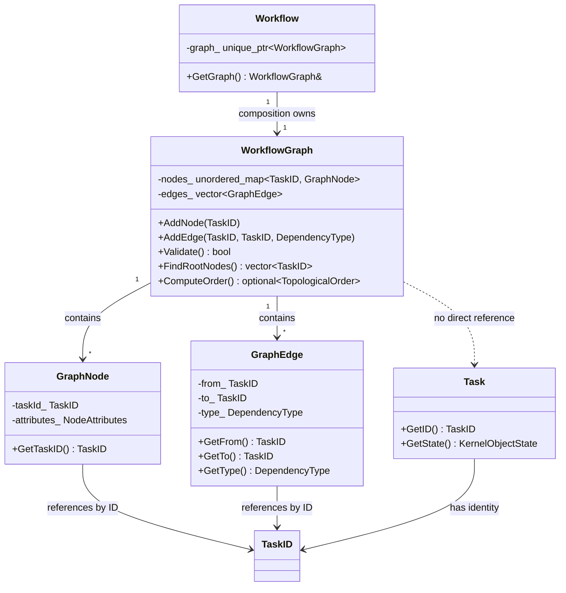
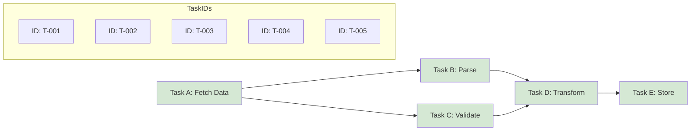

# AK0013 �Workflow Topology Model

**Status:** Frozen  
**Version:** 1.0  
**Phase:** AVP-1 Core Foundation Prototype  
**Depends On:** AK0011 (Domain Model), AK0012 (Foundation Layer)  

---

## Chapter 1 �Purpose and Scope

### 1.1 Purpose

This specification defines the Workflow Topology Model �a lightweight structural representation of the task dependency graph within a Workflow. The topology model is the **immutable description** of *what depends on what*, separated from *how tasks execute*.

### 1.2 Scope

The topology model covers:

- Graph nodes (vertices representing tasks)
- Graph edges (dependency relationships between tasks)
- Graph structure (ownership of nodes and edges)
- Validation (cycle detection, reference integrity)
- Traversal (topological order, predecessor/successor queries)

The topology model explicitly does **not** cover:

- Task execution state (owned by Task per AK0011 �structural state only, not execution results)
- Scheduling order (owned by Scheduler, future AK0030+)
- Execution dispatch (owned by Executor, future AK0030+)
- Retry policies, timeouts, or error recovery
- Dynamic graph modification during execution
- Subgraph composition or graph versioning

### 1.3 Relationship to AK0011 and AK0012

```
AK0011 (Domain Model)     AK0012 (Foundation)     AK0013 (This Spec)
                                                                
Session ───────────────── TypedKernelObject                       
    |                                                            
    +-- owns ── Workflow ───── TypedKernelObject                  
                   |                                              
                   +-- owns ── WorkflowGraph ──── (NEW)           
                   |               |                              
                   |               +-- owns ── GraphNode          
                   |               +-- owns ── GraphEdge          
                   |               +-- uses ─── GraphAlgorithms   
                   |                                              
                   +-- owns ── Task ───────────── TypedKernelObject
```

---

## Chapter 2 �Design Principles

### 2.1 Principle: Topology Only

WorkflowGraph contains **only** structural information. It is a mathematical graph: a set of vertices (TaskID) and a set of directed edges (dependency pairs). No execution state, no runtime metadata, no object references.

**Why:** Separating structure from behavior is the foundation of the entire scheduling architecture. The Scheduler reads the graph to determine execution order. The Executor reads the Task to execute work. Neither reads the other's data.

### 2.2 Principle: TaskID Over Task*

GraphNode holds a `TaskID`, not a `Task*` or `Task&`.

**Why:**

| Aspect | TaskID | Task* |
|--------|--------|-------|
| Lifetime coupling | None | Task must outlive GraphNode |
| Serialization | Trivial (uint64_t) | Requires pointer swizzling |
| Distributed execution | Works across nodes | Local-process only |
| Testability | Easy (no Task needed) | Requires full Task setup |
| Immutability | Stable | Pointer may dangle |

### 2.3 Principle: Graph Owns Structure, Task Owns State

```
WorkflowGraph                    Task
┌──────────────────────�       ┌──────────────────────�
â”?GraphNode            â”?       â”?metadata_ (...)      â”?
â”?  taskId_ = 42       â”?       â”?state_ (kRunning)    â”?
â”?  attributes_ = ...  â”?       â”?contract_            â”?
â”?                     â”?       â”?observerRegistry_    â”?
â”?GraphEdge            â”?       â”?dependencies_        â”?
â”?  from_ = 42         â”?       â”?  [TaskID 41]        â”?
�  to_ = 17           �       └──────────────────────�
└──────────────────────�
     �references by ID only
```

### 2.4 Principle: Scheduler is Separated

WorkflowGraph is consumed by the Scheduler (future AK0030+), but it does not know about the Scheduler. The dependency is one-directional:

```
WorkflowGraph  �(used by) �Scheduler  �(uses) �Executor
      �                                         �
 No knowledge of Scheduler                  No knowledge of Executor
```

### 2.5 Principle: Defer Advanced Capabilities

The following are intentionally deferred:

| Capability | Deferred To | Reason |
|-----------|-------------|--------|
| Dynamic graph (add/remove at runtime) | AK0030+ | Requires execution model first |
| Subgraph composition | AK0040+ | Requires plugin/module system |
| Graph versioning | AK0050+ | Requires persistence model |
| Incremental topological sort | AK0030+ | Requires execution profiling |
| Distributed graph | AK0060+ | Requires network model |

---

## Chapter 3 �Component Specification

### 3.1 WorkflowGraph

**File:** `include/agent_kernel/workflow/workflow_graph.hpp`

**Purpose:** Owns the topology of one Workflow's task dependency graph.

**Responsibilities:**

| Responsibility | Detail |
|---------------|--------|
| Own nodes | `unordered_map<TaskID, GraphNode>` �fast lookup by ID |
| Own edges | `vector<GraphEdge>` �ordered edge list |
| Validate | Delegates to `ValidateGraph()` in graph_algorithms |
| Traverse | Delegates to ComputeTopologicalOrder(), GetPredecessors(), etc. |
| Query | FindRootNodes, FindLeafNodes, HasNode, HasEdge |

**Owner:** Workflow (composition, `unique_ptr<WorkflowGraph>`)

**Children:** GraphNode, GraphEdge

**Dependencies:** None on Kernel Objects. Uses only TaskID (value type).

### 3.2 GraphNode

**File:** `include/agent_kernel/workflow/graph_node.hpp`

**Purpose:** One vertex in the topology graph.

**Contents:**

| Field | Type | Purpose |
|-------|------|---------|
| `taskId_` | `TaskID` | Stable identity of the corresponding Task |
| `attributes_` | `NodeAttributes` | Structural metadata (future extension) |

**What it does NOT contain:**
- No `Task*` or `Task&` �only the ID
- No execution state �Task owns that
- No runtime metadata �KernelMetadata in the Task owns that

### 3.3 GraphEdge

**File:** `include/agent_kernel/workflow/graph_edge.hpp`

**Purpose:** One directed dependency relationship between two nodes.

**Contents:**

| Field | Type | Purpose |
|-------|------|---------|
| `from_` | `TaskID` | The dependent task (depends on `to_`) |
| `to_` | `TaskID` | The task that must complete first |
| `type_` | `DependencyType` | Classification of the dependency |

**DependencyType values:**

| Value | Meaning |
|-------|---------|
| `kDataDependency` | Task[from] requires output data from Task[to] |
| `kControlDependency` | Task[from] requires Task[to] to finish (any outcome) |

### 3.4 GraphAlgorithms

**File:** `include/agent_kernel/workflow/graph_algorithms.hpp`

**Purpose:** Declares the interface for all graph algorithms. No implementation �only function signatures.

**Declared functions:**

| Function | Returns | Purpose |
|----------|---------|---------|
| `ValidateGraph()` | `bool` | Checks cycles + reference integrity |
| `ComputeTopologicalOrder()` | `optional<TopologicalOrder>` | Topological sort; nullopt if cycle |
| `DetectCycle()` | `CycleInfo` | Returns one cycle path if present |
| `GetPredecessors()` | `vector<TaskID>` | Direct predecessors of a node |
| `GetSuccessors()` | `vector<TaskID>` | Direct successors of a node |
| `FindRootNodes()` | `vector<TaskID>` | Nodes with no incoming edges |
| `FindLeafNodes()` | `vector<TaskID>` | Nodes with no outgoing edges |
| `CountNodes()` | `size_t` | Total vertex count |
| `CountEdges()` | `size_t` | Total edge count |

---

## Chapter 4 �Ownership and Dependency

### 4.1 Ownership Hierarchy

```
Workflow
  └── unique_ptr ── WorkflowGraph
                       ├── unordered_map<TaskID, GraphNode>
                       └── vector<GraphEdge>
```

### 4.2 Dependency Table

| Component | Depends On | Does NOT Depend On |
|-----------|-----------|-------------------|
| WorkflowGraph | GraphNode, GraphEdge, GraphAlgorithms, TaskID | Task, Session, Scheduler, Executor |
| GraphNode | TaskID | Task (no pointer) |
| GraphEdge | TaskID, DependencyType | Task |
| GraphAlgorithms | WorkflowGraph, TaskID | Task, Session, Scheduler |

### 4.3 Dependency Rules

1. **Workflow owns WorkflowGraph.** When Workflow is destroyed, the graph is destroyed. No external code retains a handle to the graph after its parent Workflow is destroyed.
2. **GraphNode never references Task.** The only connection between topology and execution is the TaskID value. This is intentional and enforced at the type level.
3. **GraphAlgorithms are free functions, not methods.** They operate on `const WorkflowGraph&` and produce structural results. They are not part of the graph object to allow future algorithm selection (e.g., parallel topological sort).
4. **No cross-graph references.** A WorkflowGraph never contains TaskIDs that belong to a different Workflow. This invariant is maintained by Workflow when adding tasks.

---

## Chapter 5 �Design Alternatives Considered

### 5.1 Alternative A: Graph Contains Task Pointers

**Proposed:** GraphNode stores `Task*` instead of `TaskID`.

**Rejected because:**

| Issue | Impact |
|-------|--------|
| Lifetime coupling | Graph cannot outlive Task. Prevents graph analysis without task execution. |
| Testability | Every graph test requires creating Task objects. |
| Distributed execution | Impossible �pointers are process-local. |
| Serialization | Requires pointer swizzling for every graph operation. |

**Verdict:** Rejected. TaskID provides all necessary capabilities without coupling.

### 5.2 Alternative B: Graph Owns Execution State

**Proposed:** GraphNode stores execution state (Running, Completed, etc.).

**Rejected because:**

| Issue | Impact |
|-------|--------|
| Duplicated state | Task already owns state. Dual ownership causes inconsistency. |
| Violates SRP | Graph would own both structure and behavior. |
| Scheduler confusion | Scheduler would not know whether to read state from Graph or Task. |

**Verdict:** Rejected. The separation of concerns (Graph = structure, Task = execution) is foundational.

### 5.3 Alternative C: Full Graph Engine (Boost.Graph Wrapper)

**Proposed:** Wrap Boost.Graph or a similar graph library.

**Rejected because:**

| Issue | Impact |
|-------|--------|
| Dependency weight | Boost.Graph is large. Agent Kernel needs only DAG traversal. |
| Over-abstraction | The algorithm interface is ~9 functions. A full graph library would expose 100+. |
| Build complexity | Third-party dependency for a lightweight abstraction. |

**Verdict:** Rejected. A custom lightweight graph (unordered_map + vector) meets all requirements without external dependencies.

### 5.4 Alternative D: Graph Inherits from KernelObject

**Proposed:** WorkflowGraph inherits TypedKernelObject.

**Rejected because:**

| Issue | Impact |
|-------|--------|
| No lifecycle | Graph does not have a state machine. It is always "ready" or "empty". |
| No identity | Graph is identified by its owning Workflow, not by its own ID. |
| No observation | Graph does not emit events. The Workflow emits events. |

**Verdict:** Rejected. WorkflowGraph is a value/container type owned by Workflow, not a first-class Kernel Object.

---

## Chapter 6 �Mermaid Diagrams

### 6.1 Object Relationship



### 6.2 Dependency Graph Example



Topological order: T-001, T-002, T-003, T-004, T-005 (also valid: T-001, T-003, T-002, T-004, T-005)

Root nodes: T-001  
Leaf nodes: T-005  
Predecessors of T-004: T-002, T-003

### 6.3 Layer Diagram

```mermaid
graph TD
    subgraph "Domain Layer (AK0011)"
        W[Workflow]
        T[Task]
    end

    subgraph "Topology Layer (AK0013)"
        WG[WorkflowGraph]
        GN[GraphNode]
        GE[GraphEdge]
        GA[GraphAlgorithms]
    end

    subgraph "Foundation Layer (AK0012)"
        KO[KernelObject]
        OID[KernelObjectID]
    end

    subgraph "Future Runtime Layers"
        SCH[Scheduler]
        EX[Executor]
    end

    W --> WG : owns
    W --> T : owns
    WG --> GN : contains
    WG --> GE : contains
    GA --> WG : reads
    T --> OID : has identity
    T --> KO : inherits

    SCH -.-> WG : will read
    SCH -.-> EX : will dispatch to
```

### 6.4 Topology vs Runtime Separation

```mermaid
graph LR
    subgraph "Compile Time / Topology"
        direction TB
        WG[WorkflowGraph]
        GN[GraphNode: TaskID only]
        GE[GraphEdge: depends on]
    end

    subgraph "Domain Layer / Task Description"
        direction TB
        T[Task object]
        TS[Task::state_ = kRunning]
        TC[Task::contract_]
        TD[Task::executionDescriptor_]
    end

    WG -- "references by TaskID" --> T
    T -- "has ID" --> GN

    style WG fill:#dae8fc
    style GN fill:#dae8fc
    style GE fill:#dae8fc
    style T fill:#d5e8d4
    style TC fill:#d5e8d4
    style TD fill:#d5e8d4

**Note:** Task does NOT own execution results. The Core Domain describes execution intent only. Execution results are produced and managed by future Runtime/Executor components (AK0030+).e TS fill:#d5e8d4
    style TR fill:#d5e8d4
```

---

## Chapter 7 �Interface Inventory

| File | Lines | Declares |
|------|-------|----------|
| `workflow_graph.hpp` | ~90 | `WorkflowGraph` class with 20 methods |
| `graph_node.hpp` | ~60 | `GraphNode` class, `NodeAttributes` struct |
| `graph_edge.hpp` | ~60 | `GraphEdge` class, `DependencyType` enum |
| `graph_algorithms.hpp` | ~80 | 9 algorithm function declarations, `TopologicalOrder`, `CycleInfo` |

---

## Chapter 8 �Future Extension Points

| Extension | Impact on Topology Model | When |
|-----------|-------------------------|------|
| Weighted edges | Add `weight` field to GraphEdge | AK0030+ (Scheduling) |
| Node capabilities | Extend NodeAttributes struct | AK0020+ (Memory/Context) |
| Parallel traversal | Add parallel algorithm overloads | AK0030+ (Concurrency) |
| Incremental sort | New algorithm function | AK0030+ (Dynamic graphs) |
| Subgraph reference | Add SubgraphID field to GraphNode | AK0040+ (Composition) |
| Graph diff | New comparison functions | AK0050+ (Versioning) |

---

*End of AK0013 �Workflow Topology Model*
