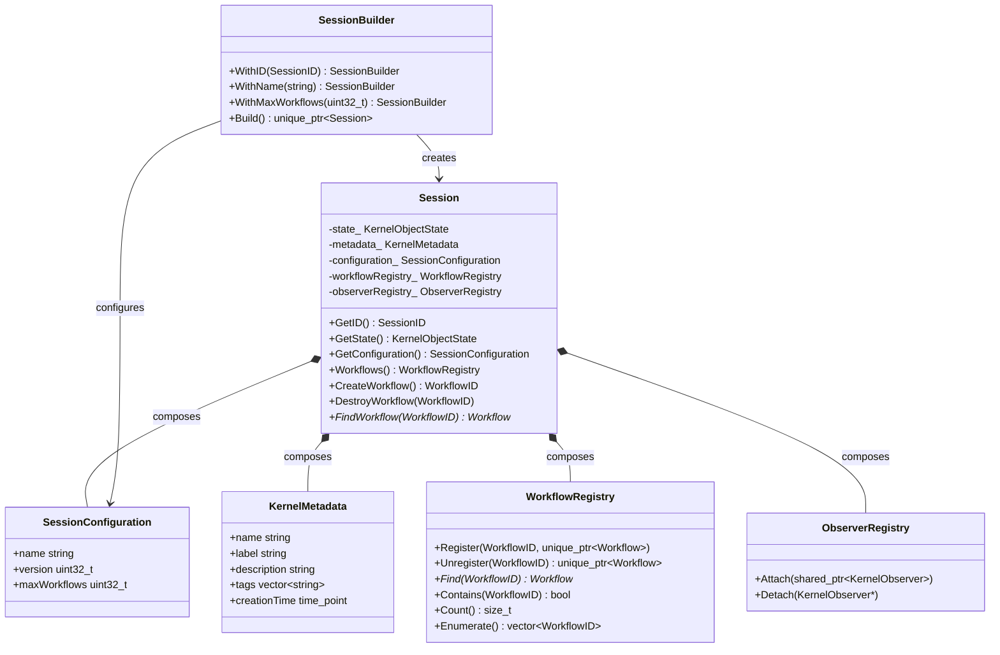

# AK0014 �Session Specification

**Status:** Frozen  
**Version:** 1.0  
**Phase:** AVP-1 Core Foundation Prototype  
**Depends On:** AK0011 (Domain Model), AK0012 (Foundation Layer), AK0013 (Workflow Topology)  

---

## Chapter 1 �Purpose and Scope

### 1.1 Purpose

This specification defines the Session object �the root of the Agent Kernel object hierarchy. Session is the ownership boundary, lifecycle controller, and execution scope for all Kernel Objects within one logical execution environment.

### 1.2 Scope

This specification covers:

- Session responsibilities and ownership model
- Session internal composition (WorkflowRegistry, Configuration, Metadata)
- SessionBuilder construction abstraction
- SessionConfiguration value object
- Session lifecycle and public API
- Dependency rules and future runtime integration

### 1.3 Relationship to AK0011, AK0012, AK0013

```
AK0011 (Domain) ─── defines ─── Session as root Kernel Object
                                      â”?
AK0012 (Foundation) ─── provides ─── TypedKernelObject, ObserverRegistry,
                                      KernelMetadata, KernelContracts
                                      â”?
AK0013 (Topology) ─── provides ─── WorkflowGraph (owned by Workflow)
                                      â”?
AK0014 (This Spec) ─── specifies ─── Session composition, WorkflowRegistry,
                                      SessionBuilder, SessionConfiguration
```

AK0011 defined the *what* (Session exists). AK0014 defines the *how* (Session's internal structure and construction).

---

## Chapter 2 �Session Responsibilities

### 2.1 Responsibility Table

| Responsibility | Owner | Why It Belongs to Session |
|---------------|-------|---------------------------|
| Own Workflows | Session | Session is the root ownership boundary. Workflows cannot outlive their parent Session. |
| Manage Workflow lifetime | Session | Only Session creates and destroys Workflows. No external code can destroy a Workflow directly. |
| Provide Workflow lookup | Session | WorkflowRegistry is an internal component of Session. Callers go through Session to find Workflows. |
| Expose configuration | Session | SessionConfiguration is an immutable snapshot of construction parameters. It is part of Session identity, not runtime state. |
| Expose lifecycle state | Session | Session's state (Created �Initialized �... �Destroyed) is the top-level lifecycle signal for the entire execution environment. |
| Expose observer notifications | Session | Observers track Session-level events (WorkflowCreated, WorkflowDestroyed, state changes). |

### 2.2 Excluded Responsibilities

| Responsibility | Owner | Why It Does NOT Belong to Session |
|---------------|-------|------------------------------------|
| Execute Workflows | Scheduler (future AK0030+) | Session provides the scope. Scheduler determines *when* and *in what order* Workflows execute. |
| Execute Tasks | Executor (future AK0030+) | Session does not know about individual Tasks. Task execution is delegated through Workflow �Scheduler �Executor. |
| Schedule Tasks | Scheduler | The topological order is in WorkflowGraph. The ordering algorithm belongs to Scheduler. |
| Dispatch events | EventBus (future AK0040+) | Session emits observer notifications. Cross-component event distribution belongs to EventBus. |
| Retry failed Tasks | Executor / Policy | Retry is an execution policy. Session is a structural boundary, not a policy engine. |
| Store runtime state | Runtime (future AK0060+) | Runtime state (active Workflow handles, execution contexts) is transient and belongs to the Runtime layer. |

---

## Chapter 3 �Ownership Model

### 3.1 Ownership Hierarchy

```
Session (root)
  â”?
  ├── unique_ptr ── WorkflowRegistry (internal, NOT a Domain Object)
  â”?                   â”?
  �                   └── vector<pair<WorkflowID, unique_ptr<Workflow>>>
  â”?
  ├── value ── SessionConfiguration (immutable)
  â”?
  ├── value ── KernelMetadata (mutable, for display)
  â”?
  └── value ── ObserverRegistry (mutable, composed)

Workflow (AK0011)
  â”?
  ├── unique_ptr ── WorkflowGraph (AK0013)
  â”?                   â”?
  �                   ├── unordered_map<TaskID, GraphNode>
  �                   └── vector<GraphEdge>
  â”?
  ├── unique_ptr ── Task instances
  └── value ── ObserverRegistry
```

### 3.2 Ownership Rules

1. **Session exclusively owns WorkflowRegistry.** No external code holds a `unique_ptr` to the registry. Access to individual Workflows is through `Find()` or `Enumerate()` �the registry retains ownership.
2. **WorkflowRegistry is NOT a Kernel Object.** It does not have an ID, state machine, lifecycle, or observer interface. It is an implementation detail of Session. This distinction is critical: if WorkflowRegistry were a Kernel Object, it would need to follow the same lifecycle as Session, Workflow, and Task �which is meaningless for a registry.
3. **Workflow lifetime is controlled only by Session.** `DestroyWorkflow()` is the exclusive destruction path. No `Workflow` destructor is called from outside Session.
4. **No shared ownership.** All ownership uses `std::unique_ptr`. There is no `std::shared_ptr<KernelObject>` in the ownership hierarchy.

---

## Chapter 4 �Internal Components

### 4.1 WorkflowRegistry

**File:** `include/agent_kernel/session/workflow_registry.hpp`

**Status:** Internal implementation component (NOT a Kernel Domain Object)

**Purpose:** Provides O(1) lookup and ownership management for Workflow instances.

**API:**

| Method | Returns | Purpose |
|--------|---------|---------|
| `Register(WorkflowID, unique_ptr<Workflow>)` | void | Transfers ownership of a Workflow to the registry |
| `Unregister(WorkflowID)` | `unique_ptr<Workflow>` | Removes a Workflow from the registry (returns ownership) |
| `Find(WorkflowID)` | `Workflow*` | Non-owning pointer for lookup |
| `Contains(WorkflowID)` | `bool` | Existence check |
| `Count()` | `size_t` | Total Workflows |
| `Enumerate()` | `vector<WorkflowID>` | List all registered IDs |

**Why WorkflowRegistry is NOT a Kernel Object:**

| Aspect | Kernel Object | WorkflowRegistry |
|--------|--------------|------------------|
| Identity | Has KernelObjectID | No identity �identified by owning Session |
| State machine | Created �... �Destroyed | No state �always "ready" |
| Lifecycle | Initialize() �Destroy() | No lifecycle �created/destroyed with Session |
| Observers | AttachObserver/DetachObserver | No observers |
| Ownership | Owned by parent Kernel Object | Owned by Session as a value member |

### 4.2 SessionConfiguration

**File:** `include/agent_kernel/session/session_configuration.hpp`

**Status:** Immutable value object

**Fields:**

| Field | Type | Default | Purpose |
|-------|------|---------|---------|
| `name` | `string` | empty | Human-readable name |
| `version` | `uint32_t` | 1 | Configuration schema version |
| `maxWorkflows` | `uint32_t` | 0 (unlimited) | Capacity limit |

**Why these fields and not others:**

| Excluded Field | Belongs To | Reason |
|---------------|-----------|--------|
| Thread count | Runtime configuration | Session does not manage threads |
| Retry policy | Executor policy | Session does not execute Tasks |
| Scheduling policy | Scheduler configuration | Session does not schedule |
| Timeout | Workflow or Task | Per-execution, not per-Session |

**Why SessionConfiguration is immutable:**

SessionConfiguration is set once during construction. Mutable configuration would require Session to observe configuration changes and react �that is runtime behavior. Immutability keeps Session as a structural object.

### 4.3 SessionBuilder

**File:** `include/agent_kernel/session/session_builder.hpp`

**Status:** Lightweight construction abstraction

**Purpose:** SessionBuilder exists because:

1. **Session has required constructor parameters** (SessionID, SessionConfiguration). The builder ensures all required parameters are set before `Build()` is called.
2. **Future extension.** When Session gains additional construction parameters (e.g., initial Workflows, service registrations), the builder API evolves without changing the Session constructor.
3. **Testability.** Tests create Sessions through the builder without exposing construction internals.

**API:**

```cpp
auto session = SessionBuilder()
    .WithID(SessionID::Generate())
    .WithName("MySession")
    .WithMaxWorkflows(100)
    .Build();
```

**What SessionBuilder does NOT do:**

- Does NOT create Scheduler, Executor, or any runtime component
- Does NOT initialize services
- Does NOT start execution
- Does NOT validate configuration against environment

---

## Chapter 5 �Public Session API

### 5.1 API Table

| Method | Returns | Category |
|--------|---------|----------|
| `GetID()` | `SessionID` | Identity |
| `GetIDValue()` | `uint64_t` | Identity |
| `GetState()` | `KernelObjectState` | State |
| `GetMetadata()` | `const KernelMetadata&` | Metadata |
| `SetMetadata(KernelMetadata)` | void | Metadata |
| `GetConfiguration()` | `const SessionConfiguration&` | Configuration |
| `Initialize()` | void | Lifecycle |
| `Activate()` | void | Lifecycle |
| `Shutdown()` | void | Lifecycle |
| `Destroy()` | void | Lifecycle |
| `CreateWorkflow()` | `WorkflowID` | Workflow management |
| `DestroyWorkflow(WorkflowID)` | void | Workflow management |
| `FindWorkflow(WorkflowID)` | `Workflow*` | Workflow lookup |
| `HasWorkflow(WorkflowID)` | `bool` | Workflow lookup |
| `GetWorkflowCount()` | `size_t` | Workflow query |
| `Workflows()` | `WorkflowRegistry&` | Registry access |
| `Workflows() const` | `const WorkflowRegistry&` | Registry access |
| `AttachObserver(shared_ptr<ISessionObserver>)` | void | Observation |
| `DetachObserver(ISessionObserver*)` | void | Observation |

### 5.2 API Design Decisions

**Why `Workflows()` returns a reference to WorkflowRegistry, not a collection:**

The registry provides Find, Contains, Enumerate, and Count. Returning a collection (e.g., `vector<unique_ptr<Workflow>>`) would transfer ownership, violating the ownership model. Returning a reference to the registry preserves Session's exclusive ownership while allowing lookup.

**Why `FindWorkflow` returns `Workflow*` (raw pointer):**

The raw pointer is a non-owning observer. It is valid only as long as the Workflow is registered and the Session is alive. This is consistent with Engineering Standards Chapter 7 (observer references). The caller must not store the pointer beyond the current scope.

**Why no `Run()` or `Execute()` methods:**

Execution is not a Session responsibility. Adding `Run()` would imply Session controls execution, which belongs to Scheduler. Session is a structural boundary. Adding execution methods would couple Session to runtime concepts that have not been specified yet.

---

## Chapter 6 �Lifecycle

### 6.1 State Model

Session follows the AK0011 unified state machine:

```
kCreated ──�kInitialized ──�kReady ──�kRunning ──�kCompleted ──�kDestroyed
                                         â”?
                                         └──�kFailed ──�kDestroyed
```

### 6.2 State Semantics for Session

| State | Meaning for Session |
|-------|---------------------|
| kCreated | SessionID assigned, Configuration stored. No Workflows yet. |
| kInitialized | Metadata set, ObserverRegistry ready. Ready to accept Workflow creation. |
| kReady | Session is fully configured and accepting Workflows. |
| kRunning | Session is active (delegated to future Runtime for execution). |
| kSuspended | Session temporarily paused (future �for resource management). |
| kCompleted | All Workflows completed, Session shutting down gracefully. |
| kFailed | Irrecoverable error occurred. |
| kDestroyed | All resources released. Terminal state. |

### 6.3 State Transition Ownership

Session exposes state transitions (`Initialize()`, `Activate()`, `Shutdown()`, `Destroy()`). The actual transition logic belongs to the future Runtime. Session's state methods are **declared but not implemented** in this specification �they become real when the Runtime calls them.

---

## Chapter 7 �Dependency Rules

### 7.1 Dependency Table

| Component | Depends On | Does NOT Depend On |
|-----------|-----------|-------------------|
| Session | TypedKernelObject, KernelMetadata, ObserverRegistry, SessionConfiguration, WorkflowRegistry, Workflow, WorkflowID, SessionID, KernelObjectState | Scheduler, Executor, EventBus, Memory, Context, Plugin, Runtime, Networking, Persistence |
| WorkflowRegistry | WorkflowID, Workflow (unique_ptr) | WorkflowGraph, Task, Scheduler, Executor |
| SessionConfiguration | (standalone �no Agent Kernel dependencies) | All runtime components |
| SessionBuilder | SessionID, SessionConfiguration, Session | Scheduler, Executor |

### 7.2 Dependency Graph

```
Session
  ├── foundation::TypedKernelObject (AK0012)
  ├── foundation::KernelMetadata (AK0012)
  ├── foundation::ObserverRegistry (AK0012)
  ├── session::SessionConfiguration (AK0014) �standalone
  ├── session::WorkflowRegistry (AK0014)
  �    └── Workflow (AK0011)
  �          ├── WorkflowGraph (AK0013)
  �          └── Task (AK0011)
  └── session::SessionBuilder (AK0014)
        └── SessionConfiguration, SessionID, Session
```

### 7.3 Future Injection Points

When Runtime is specified (AK0060+), Session receives its dependencies via injection:

```cpp
// Future: Runtime owns Session and injects dependencies
class Runtime {
    std::unique_ptr<Session> session_;
    std::unique_ptr<Scheduler> scheduler_;  // AK0030+
    std::unique_ptr<EventBus> eventBus_;    // AK0040+
};
```

---

## Chapter 8 �Design Alternatives Considered

### 8.1 Alternative A: WorkflowRegistry as Kernel Object

**Proposed:** WorkflowRegistry inherits TypedKernelObject.

**Rejected because:**

| Issue | Impact |
|-------|--------|
| Meaningless lifecycle | `WorkflowRegistry::Initialize()` and `::Destroy()` have no operational meaning |
| Artificial identity | Registry is identified by its owning Session, not by its own ID |
| Observer confusion | Registry events are Session events. Separate observers would duplicate notifications |
| Overhead | Full Kernel Object lifecycle for a lookup table |

**Verdict:** Rejected. WorkflowRegistry is a value member of Session (composition), not a Domain Object (inheritance).

### 8.2 Alternative B: Session Has No Configuration

**Proposed:** Session takes only SessionID; all configuration is settable via setters.

**Rejected because:**

| Issue | Impact |
|-------|--------|
| Mutable configuration | Session would need to observe configuration changes |
| Incomplete construction | Session could be used before fully configured |
| Test ambiguity | Tests would need to know which setters to call |

**Verdict:** Rejected. Immutable configuration ensures Session is fully specified at construction time.

### 8.3 Alternative C: Session Exposes `Run()`

**Proposed:** Session has a `Run()` method that starts execution.

**Rejected because:**

| Issue | Impact |
|-------|--------|
| Couples Session to execution | Forces Runtime concepts into the Domain Model |
| Premature abstraction | Execution semantics are not yet specified |
| Responsibility drift | Session would own both structure and behavior |

**Verdict:** Rejected. Session is structural. Execution belongs in Scheduler and Executor.

---

## Chapter 9 �Mermaid Diagrams

### 9.1 Session Ownership

```mermaid
graph TD
    subgraph "Session Boundary"
        S[Session]
        CFG[SessionConfiguration<br/>immutable value]
        META[KernelMetadata<br/>mutable value]
        REG[WorkflowRegistry<br/>internal component]
        OBS[ObserverRegistry<br/>composed]
    end

    subgraph "Workflow Boundary (owned by Session)"
        W1[Workflow]
        W2[Workflow]
        WN[Workflow ...N]
    end

    subgraph "Kernel Foundation (AK0012)"
        TKO[TypedKernelObject]
    end

    S --- TKO : inherits
    S --- CFG : has
    S --- META : has
    S --- REG : has
    S --- OBS : has

    REG --- W1 : owns via unique_ptr
    REG --- W2 : owns via unique_ptr
    REG --- WN : owns via unique_ptr

    style S fill:#4a9,color:#fff
    style REG fill:#6a9,color:#fff
    style CFG fill:#eee
    style META fill:#eee
    style W1 fill:#48b,color:#fff
    style W2 fill:#48b,color:#fff
    style WN fill:#48b,color:#fff
```

### 9.2 Session Composition (Internal Structure)



### 9.3 Session Dependency Graph

```mermaid
graph TD
    subgraph "External Dependencies"
        OID[KernelObjectID]
        ST[KernelObjectState]
    end

    subgraph "Foundation Layer (AK0012)"
        TKO[TypedKernelObject]
        KM[KernelMetadata]
        OR[ObserverRegistry]
        KC[KernelContracts]
    end

    subgraph "Session Components (AK0014)"
        S[Session]
        SC[SessionConfiguration]
        WR[WorkflowRegistry]
        SB[SessionBuilder]
    end

    subgraph "Domain Objects (AK0011)"
        W[Workflow]
        T[Task]
    end

    subgraph "NOT Depended By Session"
        SCH[Scheduler]
        EX[Executor]
        EB[EventBus]
        MEM[Memory]
        CTX[Context]
        PLG[Plugin]
        RT[Runtime]
    end

    S --> TKO
    S --> KM
    S --> OR
    S --> KC
    S --> SC
    S --> WR
    WR --> W
    TKO --> OID
    TKO --> ST
    SB --> S
    SB --> SC
    SB --> OID

    S -.-> SCH : NO
    S -.-> EX : NO
    S -.-> EB : NO
    S -.-> MEM : NO
    S -.-> CTX : NO
    S -.-> PLG : NO
    S -.-> RT : NO
```

### 9.4 Session Lifecycle

```mermaid
stateDiagram-v2
    [*] --> kCreated : SessionBuilder::Build()
    kCreated --> kInitialized : Initialize()
    kInitialized --> kReady : Activate()
    kReady --> kRunning : (future) Runtime starts
    kRunning --> kCompleted : (future) all Workflows done
    kRunning --> kFailed : (future) irrecoverable error
    kCompleted --> kDestroyed : Destroy()
    kFailed --> kDestroyed : Destroy()
    kDestroyed --> [*]

    note right of kRunning
        Session exposes state.
        Transition logic belongs
        to future Runtime (AK0060+).
    end note
```

---

## Chapter 10 �Interface Inventory

| File | Lines | Status | Content |
|------|-------|--------|---------|
| `include/agent_kernel/session.hpp` | ~95 | Updated | Session class + ISessionObserver, now composes WorkflowRegistry + SessionConfiguration |
| `include/agent_kernel/session/session_configuration.hpp` | ~45 | New | SessionConfiguration value struct |
| `include/agent_kernel/session/workflow_registry.hpp` | ~70 | New | WorkflowRegistry internal component (NOT Kernel Object) |
| `include/agent_kernel/session/session_builder.hpp` | ~55 | New | SessionBuilder for construction abstraction |

---

## Chapter 11 �Engineering Decisions

| # | Decision | Rationale |
|---|----------|-----------|
| 1 | SessionConfiguration is immutable | Prevents runtime configuration drift. All configuration is fixed at construction time. |
| 2 | WorkflowRegistry is NOT a Kernel Object | Registry has no lifecycle, state, identity, or observers �it is a lookup table. |
| 3 | WorkflowRegistry stores vector<pair<ID, unique_ptr>> | Simple, deterministic iteration order. Not hash-based �Workflow counts are small. |
| 4 | SessionBuilder is separate from Session | Keeps construction concerns out of the Session class. Builder evolves independently. |
| 5 | Session does not accept Scheduler/Executor at construction | Those dependencies belong to Runtime. Session is constructed before Runtime exists. |
| 6 | `FindWorkflow()` returns raw pointer, not shared_ptr | Non-owning observer. Lifetime is bounded by Session lifetime. Callers must not store it. |

---

## Chapter 12 �Future Integration

### 12.1 Runtime Integration (AK0060+)

When Runtime is specified, Runtime will:

1. Create Session via SessionBuilder
2. Inject Scheduler, Executor, EventBus into the execution environment (not into Session)
3. Drive Session lifecycle transitions
4. Route Session observer notifications through EventBus

### 12.2 Memory Integration (AK0020+)

Memory will be added as a component of Session:

```cpp
// Future
class Session {
    void SetMemory(std::unique_ptr<Memory> memory);
    Memory& GetMemory();
};
```

### 12.3 Context Integration (AK0020+)

Context will be associated with Session:

```cpp
// Future
class Session {
    void SetContext(std::shared_ptr<Context> rootContext);
};
```

---

*End of AK0014 �Session Specification*
