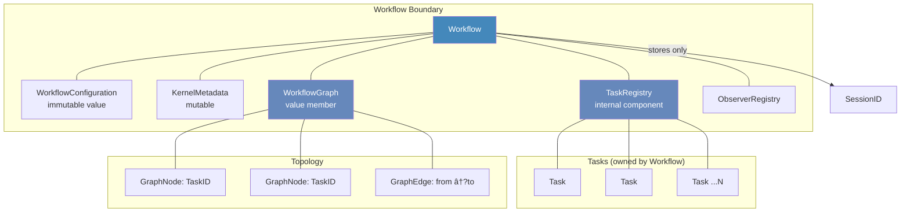
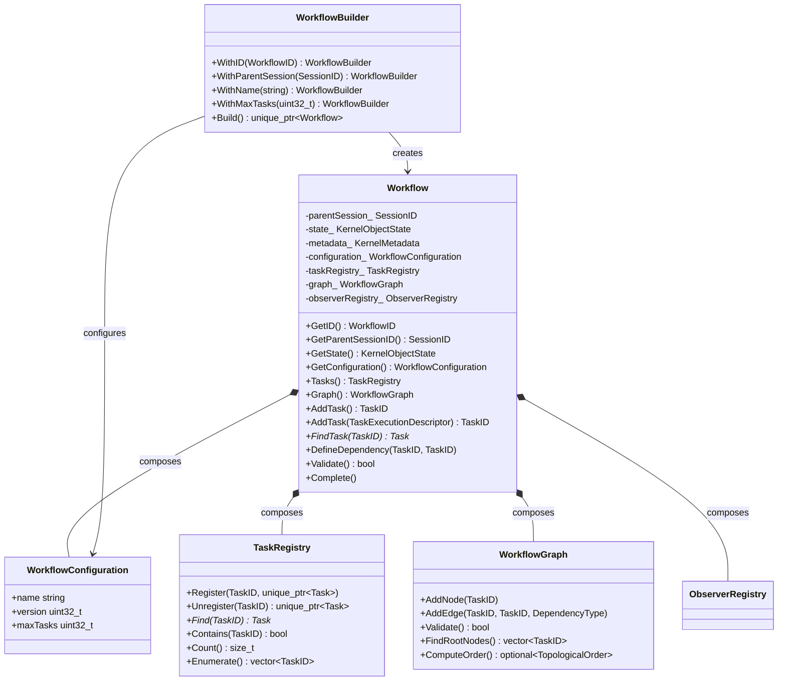

# AK0015 �Workflow Specification

**Status:** Frozen  
**Version:** Revision 2  
**Phase:** AVP-1 Core Foundation Prototype  
**Depends On:** AK0011, AK0012, AK0013, AK0014  

---

## Chapter 1 �Purpose and Scope

### 1.1 Purpose

This specification defines the Workflow object �the structural container for executable Tasks and the owner of the Workflow Topology Model. Workflow is the middle layer of the three-tier Kernel Object hierarchy (Session �Workflow �Task).

### 1.2 Scope

This specification covers:

- Workflow responsibilities and ownership model
- Workflow internal composition (TaskRegistry, WorkflowGraph, Configuration, Metadata)
- WorkflowBuilder construction abstraction
- WorkflowConfiguration immutable value object
- Workflow lifecycle and public API
- Dependency rules and relationship to Session

### 1.3 Relationship to Prior Specifications

```
AK0011 ─── Domain Model: Workflow is the middle tier
AK0012 ─── Foundation: TypedKernelObject, ObserverRegistry, KernelMetadata
AK0013 ─── Topology: WorkflowGraph, GraphNode, GraphEdge, GraphAlgorithms
AK0014 ─── Session: owns Workflow, stores WorkflowRegistry
AK0015 ─── (This spec): Workflow composition, TaskRegistry, WorkflowConfiguration
```

---

## Chapter 2 �Workflow Responsibilities

### 2.1 Responsibility Table

| Responsibility | Owner | Why It Belongs to Workflow |
|---------------|-------|---------------------------|
| Own Task objects | Workflow | Tasks are execution units within one orchestration. No external object should own a Task. |
| Own WorkflowGraph | Workflow | The graph describes how this Workflow's Tasks relate. Graph lifetime = Workflow lifetime. |
| Provide Task lookup | Workflow | TaskRegistry is an internal component. Callers go through Workflow to find Tasks. |
| Expose topology | Workflow | WorkflowGraph is composed into Workflow. External consumers (Scheduler) read the graph through Workflow. |
| Validate task graph | Workflow (delegated to WorkflowGraph) | Validation checks structural integrity (no cycles, all refs valid). This belongs with the graph. |
| Expose configuration | Workflow | WorkflowConfiguration is set at construction and read-only. It is part of Workflow identity. |
| Construct Tasks with immutable TaskExecutionDescriptor | Workflow | Workflow is the exclusive owner of Task creation and therefore constructs every Task with its immutable execution descriptor. |

### 2.2 Excluded Responsibilities

| Responsibility | Owner | Why It Does NOT Belong to Workflow |
|---------------|-------|------------------------------------|
| Execute Tasks | Executor (future AK0030+) | Workflow is a structural container. Execution is a runtime behavior. |
| Schedule Tasks | Scheduler (future AK0030+) | Workflow owns the graph. Scheduler reads the graph to determine order. |
| Evaluate graph readiness | Scheduler | "Which Tasks are ready to run?" requires combining topology with execution state. Workflow has neither. |
| Traverse graph internally | GraphAlgorithms (AK0013) | Algorithms are free functions operating on WorkflowGraph. Workflow delegates. |
| Retry failed Tasks | Executor / Policy | Retry is an execution policy, not a structural concern. |
| Store Session reference | Workflow stores SessionID only | No parent pointer. SessionID allows lookup without coupling lifetimes. |

---

## Chapter 3 �Ownership Model

### 3.1 Ownership Hierarchy

```
Workflow
  â”?
  ├── unique_ptr ── TaskRegistry (internal, NOT a Domain Object)
  â”?                   â”?
  �                   └── vector<pair<TaskID, unique_ptr<Task>>>
  â”?
  ├── value ── WorkflowGraph (composed, owns unordered_map + vector)
  â”?               â”?
  �               ├── unordered_map<TaskID, GraphNode>
  �               └── vector<GraphEdge>
  â”?
  ├── value ── WorkflowConfiguration (immutable)
  ├── value ── KernelMetadata (mutable)
  └── value ── ObserverRegistry (mutable)
```

### 3.2 Ownership Rules

1. **Workflow exclusively owns TaskRegistry.** No external code holds a `unique_ptr` to the registry. Access to individual Tasks is through `Find()` or `Tasks()` �the registry retains ownership.
2. **TaskRegistry is NOT a Kernel Object.** It has no identity, state machine, lifecycle, or observer interface. It is an implementation detail.
3. **WorkflowGraph is a value member (composition), not a pointer.** Graph lifetime is exactly the Workflow lifetime. There is no reason to share a graph across Workflows.
4. **WorkflowGraph references Tasks only through TaskID.** No `Task*` is stored in the graph. This preserves the topology-only principle from AK0013.
5. **No shared ownership.** All ownership uses `std::unique_ptr`.
6. **Workflow owns Task construction including descriptor.** TaskExecutionDescriptor becomes part of the Task during construction. Descriptor ownership never transfers to Runtime. Runtime may read the descriptor through Task::GetExecutionDescriptor() but must not own or cache it. Workflow::AddTask(const TaskExecutionDescriptor&) is the sole public API for constructing a Task with a configured descriptor.

---

## Chapter 4 �Internal Components

### 4.1 TaskRegistry

**File:** `include/agent_kernel/workflow/task_registry.hpp`

**Status:** Internal implementation component (NOT a Kernel Domain Object)

**API:**

| Method | Returns | Purpose |
|--------|---------|---------|
| `Register(TaskID, unique_ptr<Task>)` | void | Transfers ownership of a Task to the registry |
| `Unregister(TaskID)` | `unique_ptr<Task>` | Removes a Task from the registry |
| `Find(TaskID)` | `Task*` | Non-owning pointer for lookup |
| `Contains(TaskID)` | `bool` | Existence check |
| `Count()` | `size_t` | Total Tasks |
| `Enumerate()` | `vector<TaskID>` | List all registered IDs |

**Why TaskRegistry is NOT a Kernel Object (same reasoning as WorkflowRegistry in AK0014):**

| Aspect | Kernel Object | TaskRegistry |
|--------|--------------|-------------|
| Identity | Has KernelObjectID | No identity �identified by owning Workflow |
| State machine | Created �... �Destroyed | No state |
| Lifecycle | Initialize() �Destroy() | No lifecycle |
| Observers | AttachObserver/DetachObserver | No observers |

### 4.2 WorkflowGraph

**File:** `include/agent_kernel/workflow/workflow_graph.hpp`

**Specification:** AK0013

WorkflowGraph is fully specified by AK0013. It is composed as a value member into Workflow. No modifications are needed.

### 4.3 WorkflowConfiguration

**File:** `include/agent_kernel/workflow/workflow_configuration.hpp`

**Status:** Immutable value object

**Fields:**

| Field | Type | Default | Purpose |
|-------|------|---------|---------|
| `name` | `string` | empty | Human-readable name |
| `version` | `uint32_t` | 1 | Configuration schema version |
| `maxTasks` | `uint32_t` | 0 (unlimited) | Capacity limit |

**Excluded fields rationale:**

| Excluded Field | Belongs To | Reason |
|---------------|-----------|--------|
| Scheduling policy | Scheduler configuration | Workflow does not schedule |
| Retry policy | Executor policy | Workflow does not execute |
| Timeout | Executor or per-Task | Per-execution, not per-Workflow structure |
| Concurrency limits | Executor configuration | Belongs to the execution engine |

### 4.4 WorkflowBuilder

**File:** `include/agent_kernel/workflow/workflow_builder.hpp`

**Status:** Lightweight construction abstraction

**API:**

```cpp
auto workflow = WorkflowBuilder()
    .WithID(WorkflowID::Generate())
    .WithParentSession(sessionId)
    .WithName("DataPipeline")
    .WithMaxTasks(50)
    .Build();
```

**What WorkflowBuilder does NOT do:**
- Does NOT create Scheduler, Executor, or any runtime component
- Does NOT initialize Task graph
- Does NOT validate against Session capacity limits (Session does that)

---

## Chapter 5 �Public API

### 5.1 API Table

| Method | Returns | Category |
|--------|---------|----------|
| `GetID()` | `WorkflowID` | Identity |
| `GetIDValue()` | `uint64_t` | Identity |
| `GetParentSessionID()` | `SessionID` | Parent (ID only �no pointer) |
| `GetState()` | `KernelObjectState` | State |
| `GetMetadata()` | `const KernelMetadata&` | Metadata |
| `SetMetadata(KernelMetadata)` | void | Metadata |
| `GetConfiguration()` | `const WorkflowConfiguration&` | Configuration |
| `Initialize()` | void | Lifecycle |
| `Activate()` | void | Lifecycle |
| `Start()` | void | Lifecycle |
| `Complete()` | void | Lifecycle |
| `Cancel()` | void | Lifecycle |
| `Destroy()` | void | Lifecycle |
| `AddTask()` | `TaskID` | Task management |
| AddTask(const TaskExecutionDescriptor&) | TaskID | Task management (constructs Task with immutable descriptor) |
| `RemoveTask(TaskID)` | void | Task management |
| `FindTask(TaskID)` | `Task*` | Task lookup |
| `HasTask(TaskID)` | `bool` | Task lookup |
| `GetTaskCount()` | `size_t` | Task query |
| `DefineDependency(TaskID, TaskID)` | void | Topology mutation |
| `Validate()` | `bool` | Topology validation |
| `Graph()` | `const WorkflowGraph&` | Topology read |
| `Tasks()` | `TaskRegistry&` | Registry access (mutable) |
| `Tasks() const` | `const TaskRegistry&` | Registry access (const) |
| `AttachObserver(shared_ptr<IWorkflowObserver>)` | void | Observation |
| `DetachObserver(IWorkflowObserver*)` | void | Observation |

### 5.2 API Design Decisions

**Why `Graph()` returns `const WorkflowGraph&`:**

The graph is read by external consumers (Scheduler). It must be `const` to prevent external mutation. Only `Workflow` mutates the graph (via `AddTask`, `DefineDependency`).

**Why `FindTask` returns `Task*`:**

Non-owning observer pointer. Valid only while the Workflow is alive. Consistent with Engineering Standards Chapter 7.

**Why no `Execute()` or `Schedule()`:**

Execution and scheduling belong to Scheduler and Executor (future AK0030+). Workflow is structural.


**Why `AddTask(const TaskExecutionDescriptor&)` exists:**

Workflow exclusively owns Task construction. Task exclusively owns `TaskExecutionDescriptor`. The descriptor must therefore be provided during Task construction. Runtime never injects descriptors after Task creation. Runtime only reads descriptors through `Task::GetExecutionDescriptor()`.

The design preserves three architectural boundaries:

1. **Workflow constructs Tasks.** No external component creates or owns a Task. The descriptor overload ensures every Task created by Workflow receives its immutable execution descriptor at the point of construction.
2. **Task owns descriptors.** `TaskExecutionDescriptor` is a private field of Task, accessible only through `const& GetExecutionDescriptor()`. No setter exists. Descriptor ownership never transfers to Runtime.
3. **Runtime consumes descriptors.** Scheduler returns `TaskID`. Executor receives the descriptor from `Task::GetExecutionDescriptor()` via the Runtime execution chain. Runtime never constructs, caches, or mutates descriptors.

**Why `Complete()` exists:**

`Complete()` requests the Workflow lifecycle transition to `kCompleted`. Workflow completion is first evaluated by the Runtime according to the Workflow Completion Policy. Only after the Runtime determines that the Workflow satisfies the completion policy may it request the Workflow to transition to `kCompleted`. The method performs only the Core Domain state transition. It performs no scheduling, execution, provider resolution, EventBus publication, or dependency evaluation.

---

## Chapter 6 �Lifecycle

### 6.1 State Model

Workflow follows the AK0011 unified state machine:

```
kCreated ──�kInitialized ──�kReady ──�kRunning ──�kCompleted ──�kDestroyed
                                         â”?
                                         └──�kFailed ──�kDestroyed
```

### 6.2 State Semantics for Workflow

| State | Meaning for Workflow |
|-------|---------------------|
| kCreated | WorkflowID assigned, Configuration stored. No Tasks yet. |
| kInitialized | Metadata set, ObserverRegistry ready. Ready to accept Task creation. |
| kReady | Workflow is fully configured, graph validated, accepting Task additions. |
| kRunning | Workflow is active (delegated to future Runtime). |
| kSuspended | Workflow temporarily paused (future). |
| kCompleted | all Tasks have reached their terminal lifecycle states |
| kFailed | Irrecoverable error (Task failure propagated). |
| kDestroyed | All resources released. Terminal state. |

### 6.3 Lifecycle Authority

Workflow owns its lifecycle state.

Runtime owns the architectural authority to evaluate lifecycle progression and request lifecycle transitions.

Lifecycle state ownership and lifecycle authority are intentionally separated.

Workflow remains the owner of lifecycle state.

Runtime never owns Workflow lifecycle state.

Workflow lifecycle progression shall therefore satisfy
the following ownership rules.

�Workflow remains the owner of Workflow state.

�Runtime evaluates whether Workflow completion
  conditions have been satisfied.

�Runtime does not become the owner of Workflow.

�Scheduler never determines Workflow completion.

�Executor never determines Workflow completion.

This specification defines the Core Domain lifecycle transition API `Complete()`.

Runtime evaluates Workflow completion policy and may request this transition.

The concrete Runtime implementation mechanism and completion policy algorithm remain outside the scope of this specification.

### 6.4 Derived Completion

Workflow completion is a derived lifecycle state.

A Workflow shall become eligible
to enter kCompleted only after
its completion conditions have
been satisfied.

Typical completion conditions include:

�all Tasks have reached their terminal lifecycle states required by the Workflow completion policy;

�Workflow completion policy has been satisfied;

�no remaining runnable Tasks exist;

�no pending execution activities remain.

Workflow completion policy is outside the scope of this specification.

Future Runtime specifications shall define the policy used to determine Workflow completion.

The evaluation of completion conditions belongs to Runtime.

Workflow completion shall never be inferred
from:

�Scheduler decisions;

�Executor execution success;

�EventBus notifications.

ExecutionResult contributes evidence
for lifecycle evaluation,
but does not itself imply Workflow completion.

Workflow completion follows this architectural sequence:

```text
Workflow Completion Policy
�
All Tasks reach the lifecycle states required by policy
�
Runtime evaluates completion conditions
�
Runtime requests Workflow::Complete()
�
Workflow state becomes kCompleted
```

ExecutionResult, Scheduler decisions, EventBus notifications, and console output are evidence only.

KernelObjectState remains authoritative for Workflow lifecycle state.

---

## Chapter 7 �Dependency Rules

### 7.1 Runtime Responsibility

Runtime is responsible for observing
Workflow execution outcomes.

Runtime evaluates whether
Workflow completion conditions
have been satisfied.

Runtime owns lifecycle authority.

Runtime does not own Workflow.

Workflow remains the sole owner
of Workflow lifecycle state.

Scheduler does not modify Workflow state.

Executor does not modify Workflow state.

EventBus does not modify Workflow state.

The Runtime implementation mechanism
is intentionally outside the scope
of this specification.

### 7.2 Dependency Table

| Component | Depends On | Does NOT Depend On |
|-----------|-----------|-------------------|
| Workflow | TypedKernelObject, KernelMetadata, ObserverRegistry, WorkflowConfiguration, TaskRegistry, WorkflowGraph, Task, TaskID, WorkflowID, SessionID, KernelObjectState | Session (only stores SessionID), Scheduler, Executor, Runtime, Memory, Context, Plugin, Networking, Persistence |
| TaskRegistry | TaskID, Task (unique_ptr) | WorkflowGraph, Scheduler, Executor |
| WorkflowConfiguration | (standalone) | All runtime modules |
| WorkflowBuilder | WorkflowID, SessionID, WorkflowConfiguration, Workflow | Scheduler, Executor, Runtime |

### 7.3 SessionID-Only Rule

Workflow stores `SessionID`, not `Session*` or `Session&`.

**Why:**

| Aspect | SessionID | Session* |
|--------|-----------|----------|
| Lifetime coupling | None | Workflow would depend on Session lifetime |
| Testability | No Session needed for Workflow tests | Requires a Session instance |
| Ownership clarity | ID is a value �no ownership implied | Pointer implies access to parent internals |
| Distributed execution | ID works across processes | Pointer is local-process only |

**Rule:** Workflow never calls methods on its parent Session. If a Workflow needs Session-level services, it goes through an injected interface (future), not through a parent pointer.

---

## Chapter 8 �Design Alternatives Considered

### 8.1 Alternative A: Workflow Stores Session* (Parent Pointer)

**Proposed:** Workflow holds `Session& parentSession_` for upward calls.

**Rejected because:**

| Issue | Impact |
|-------|--------|
| Upward dependency | Workflow would depend on Session internals (violates AK0011 dependency direction) |
| Lifetime coupling | Session must outlive Workflow. If Session is destroyed first, Workflow dangles. |
| Circular ownership | Workflow→Session reference while Session→Workflow ownership creates a reference cycle. |

**Verdict:** Rejected. `SessionID` provides all necessary identification without coupling.

### 8.2 Alternative B: TaskRegistry as Kernel Object

**Proposed:** TaskRegistry inherits TypedKernelObject.

**Rejected because** (same reasoning as AK0014 §8.1): Registry has no lifecycle, identity, state, or observers. It is a lookup table, not a Domain Object.

### 8.3 Alternative C: WorkflowGraph as Separate Allocated Object

**Proposed:** WorkflowGraph is allocated on the heap and owned via `unique_ptr<WorkflowGraph>`.

**Rejected because:**

| Issue | Impact |
|-------|--------|
| Indirection | Heap allocation for a container that lives exactly as long as Workflow |
| No sharing benefit | No other object needs to share the graph |
| Cache locality | Value member keeps graph data close to Workflow data |

**Verdict:** Rejected. WorkflowGraph is a value member. If graph serialization for distributed execution is needed, that is handled by the graph itself, not by allocation strategy.

---

## Chapter 9 �Mermaid Diagrams

### 9.1 Workflow Ownership



### 9.2 Workflow Composition



### 9.3 Workflow Dependency Graph

```mermaid
graph TD
    subgraph "Foundation (AK0012)"
        TKO[TypedKernelObject]
        KM[KernelMetadata]
        OR[ObserverRegistry]
    end

    subgraph "Topology (AK0013)"
        WG[WorkflowGraph]
        GA[GraphAlgorithms]
    end

    subgraph "Workflow Components (AK0015)"
        WF[Workflow]
        TKR[TaskRegistry]
        WFC[WorkflowConfiguration]
        WFB[WorkflowBuilder]
    end

    subgraph "Domain Objects (AK0011)"
        T[Task]
    end

    subgraph "Session (AK0014)"
        SID[SessionID]
    end

    subgraph "NOT Depended By Workflow"
        S[Session internals]
        SCH[Scheduler]
        EX[Executor]
        RT[Runtime]
    end

    WF --> TKO
    WF --> KM
    WF --> OR
    WF --> WFC
    WF --> TKR
    WF --> WG
    TKR --> T
    WG --> GA
    WFB --> WF
    WFB --> WFC
    WFB --> SID

    WF -. stores only -.-> SID
    WF -.-> S : NO
    WF -.-> SCH : NO
    WF -.-> EX : NO
    WF -.-> RT : NO
```

### 9.4 Workflow Lifecycle

```mermaid
stateDiagram-v2
    [*] --> kCreated : WorkflowBuilder::Build()
    kCreated --> kInitialized : Initialize()
    kInitialized --> kReady : Activate()
    kReady --> kRunning : (future) Scheduler starts
    kRunning --> kCompleted : Runtime requests Complete() after policy satisfied
    kRunning --> kFailed : Task failed (irrecoverable)
    kCompleted --> kDestroyed : Destroy()
    kFailed --> kDestroyed : Destroy()
    kDestroyed --> [*]

    note right of kRunning
        Runtime evaluates completion conditions.
        Workflow owns lifecycle.
        Scheduler never completes Workflow.
        Executor never completes Workflow.
    end note
```

---

## Chapter 10 �Interface Inventory

| File | Lines | Status | Content |
|------|-------|--------|---------|
| `include/agent_kernel/workflow.hpp` | ~110 | Updated | Workflow class, IWorkflowObserver, lifecycle API includes `Complete()`; composes TaskRegistry + WorkflowGraph + WorkflowConfiguration |
| include/agent_kernel/workflow.hpp | ~115 | Updated | Workflow class, IWorkflowObserver, lifecycle API includes Complete(); AddTask() overloads for default and descriptor-aware construction; composes TaskRegistry + WorkflowGraph + WorkflowConfiguration |
| `include/agent_kernel/workflow/task_registry.hpp` | ~65 | New | TaskRegistry internal component (NOT Kernel Object) |
| `include/agent_kernel/workflow/workflow_configuration.hpp` | ~40 | New | WorkflowConfiguration immutable value struct |
| `include/agent_kernel/workflow/workflow_builder.hpp` | ~55 | New | WorkflowBuilder fluent construction API |
| `include/agent_kernel/workflow/workflow_graph.hpp` | ~90 | Unchanged | WorkflowGraph (AK0013) �reused as-is |
| `include/agent_kernel/workflow/graph_algorithms.hpp` | ~80 | Unchanged | Algorithm declarations (AK0013) |
| `include/agent_kernel/workflow/graph_node.hpp` | ~60 | Unchanged | GraphNode (AK0013) |
| `include/agent_kernel/workflow/graph_edge.hpp` | ~60 | Unchanged | GraphEdge (AK0013) |

---

## Chapter 11 �Engineering Decisions

| # | Decision | Rationale |
|---|----------|-----------|
| 1 | Workflow stores SessionID only, not Session* | Prevents upward dependency and lifetime coupling. |
| 2 | TaskRegistry is NOT a Kernel Object | Registry has no lifecycle, state, identity, or observers. |
| 3 | WorkflowGraph is a value member | Graph lifetime = Workflow lifetime. No sharing needed. No indirection. |
| 4 | WorkflowConfiguration is immutable | Fixed at construction. Prevents runtime configuration drift. |
| 5 | `Graph()` returns `const&` | External consumers read the graph but must not mutate it. |
| 6 | `Tasks()` returns registry reference | Preserves Workflow's exclusive Task ownership. |
| 7 | No `Execute()` or `Schedule()` in Workflow API | Execution belongs to Scheduler/Executor (future). |
| 8 | Workflow completion is a derived lifecycle state. | Runtime owns lifecycle authority; Workflow owns lifecycle state. |
| 9 | ExecutionResult is evidence for lifecycle evaluation. | ExecutionResult does not directly complete Workflow. |
| 10 | `Complete()` performs only Workflow lifecycle state transition. | No execution, scheduling, provider resolution, EventBus publication, or dependency evaluation occurs in Workflow. |
| 11 | Workflow constructs immutable Tasks with `AddTask(const TaskExecutionDescriptor&)`. | `TaskExecutionDescriptor` is immutable per AK0016. Workflow is the exclusive owner of Task creation. The descriptor is supplied during Task construction. Runtime never mutates descriptors. Task remains the sole descriptor owner. |


---

*End of AK0015 �Workflow Specification*
