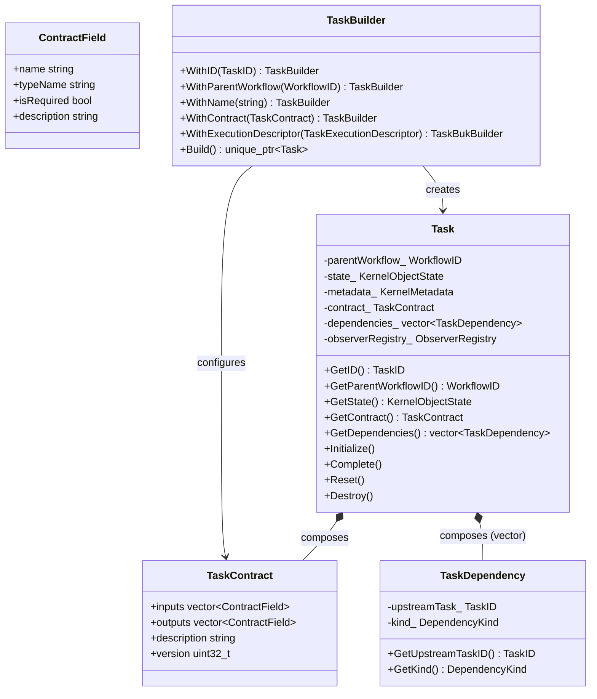
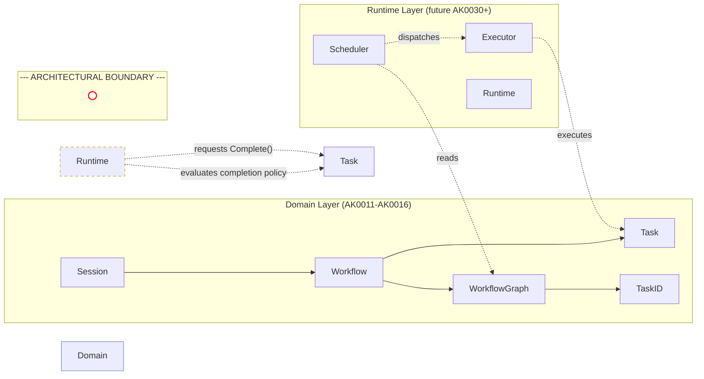

# AK0016 鈥?Task Specification

**Status:** Frozen (Revision 2 — descriptor construction clarification)  
**Version:** Revision 2  
**Phase:** AVP-1 Core Foundation Prototype  
**Depends On:** AK0011, AK0012, AK0013, AK0014, AK0015  

---

## Chapter 1 鈥?Purpose and Scope

### 1.1 Purpose

This specification defines the Task object 鈥?the smallest Kernel execution unit representation and the leaf of the three-tier Kernel Object hierarchy (Session 鈫?Workflow 鈫?Task). Task describes *what* can be executed without describing *how* execution happens.

### 1.2 Scope

This specification covers:

- Task responsibilities and ownership model
- Task identity, state, and metadata (reusing AK0012 Foundation)
- Task dependency representation (TaskID-based, no pointers)
- TaskContract input/output declaration
- TaskBuilder construction abstraction
- TaskExecutionDescriptor construction and immutability model
- Authorized Core construction paths for descriptor initialization
- Strict separation of structural description from runtime execution

### 1.3 Relationship to Prior Specifications

```
AK0011 鈹€鈹€鈹€ Domain Model: Task is the leaf Kernel Object
AK0012 鈹€鈹€鈹€ Foundation: TypedKernelObject<Task, TaskID>, KernelMetadata, ObserverRegistry
AK0013 鈹€鈹€鈹€ Topology: TaskID used in GraphNode; WorkflowGraph owns dependency edges
AK0014 鈹€鈹€鈹€ Session: unchanged by this specification
AK0015 鈹€鈹€鈹€ Workflow: owns Task via TaskRegistry; TaskRegistry Find/Enumerate uses TaskID
AK0016 鈹€鈹€鈹€ (This spec): Task composition, TaskContract, TaskDependency, TaskBuilder
```

---

## Chapter 2 鈥?Task Responsibilities

### 2.1 Responsibility Table

| Responsibility | Detail | Why It Belongs to Task |
|---------------|--------|------------------------|
| Identify itself | Provide stable TaskID | Every schedulable entity needs a unique identity for lookup, dependency reference, and observability. |
| Expose lifecycle state | Report KernelObjectState | Task has a well-defined lifecycle (kCreated鈫択Initialized鈫択Ready鈫択Running鈫択Completed/kFailed鈫択Destroyed). |
| Describe execution requirement | TaskExecutionDescriptor | Task describes *what* capability is required. Runtime resolves *how* execution happens. |
| Describe dependency metadata | List upstream TaskIDs (read-only) | Dependencies define *what* must happen before this Task can execute. The authoritative topology belongs to WorkflowGraph. |
| Declare input/output contract | TaskContract | Callers need to know what data a Task expects and produces. |
| Notify observers | ITaskObserver | Observers track Task progress, completion, and failure. |

### 2.2 Excluded Responsibilities

| Responsibility | Owner | Why It Does NOT Belong to Task |
|---------------|-------|--------------------------------|
| Execute work | Executor (future AK0030+) | Task is a description. Execution is an action performed *on* the Task by an Executor. |
| Schedule itself | Scheduler (future AK0030+) | Task does not know about time, order, or resource availability. |
| Own callable/function | Runtime execution layer | The callable is runtime state. Task is a structural object that outlives any single execution. |
| Own threads | Executor | Thread management is an Executor concern, not a Task concern. |
| Handle retry | Executor / Policy | Retry is an execution policy applied by the Executor or Runtime. |
| Persist state | Future persistence layer | Persistence is a cross-cutting concern. Task does not know about storage. |

---

## Chapter 3 鈥?Ownership Model

### 3.1 Ownership Hierarchy

```
Workflow (AK0015)
  鈹?
  鈹斺攢鈹€ unique_ptr 鈹€鈹€ TaskRegistry
                       鈹?
                       鈹斺攢鈹€ pair<TaskID, unique_ptr<Task>>
                               鈹?
                               鈹斺攢鈹€ Task
                                     鈹溾攢鈹€ value 鈹€鈹€ KernelMetadata (AK0012)
                                     鈹溾攢鈹€ value 鈹€鈹€ TaskContract (AK0016)
                                     鈹溾攢鈹€ value 鈹€鈹€ vector<TaskDependency> (AK0016)
                                     鈹斺攢鈹€ value 鈹€鈹€ TaskExecutionDescriptor (AK0016)
                                     鈹斺攢鈹€ value 鈹€鈹€ ObserverRegistry (AK0012)
```

### 3.2 Ownership Rules

1. **Workflow exclusively owns Task.** No external code holds a `unique_ptr<Task>`. Access is through TaskRegistry.
2. **Task does NOT own any Kernel Object.** Task is the leaf 鈥?it has no children.
3. **Task dependencies are value references, not ownership.** `TaskDependency` holds a `TaskID`. The upstream Task's lifetime is managed by the same Workflow's TaskRegistry.
4. **No shared ownership.** All Task ownership is `unique_ptr`. No `shared_ptr<Task>` in the system.
5. **Runtime never owns TaskExecutionDescriptor.** Runtime may obtain the descriptor only through Task::GetExecutionDescriptor(). Runtime must not cache, store, or construct descriptors as a substitute for Task ownership. The descriptor source of truth is always the Task that owns it.


### 3.3 Task Construction and Descriptor Initialization

Task construction is exclusively owned by Workflow. The `TaskExecutionDescriptor` is a private, immutable field of Task set during construction and never modified thereafter.

**Authorized construction paths:**

| Path | Description |
|------|-------------|
| `Workflow::AddTask()` | Constructs a Task with a default-constructed `TaskExecutionDescriptor`. The descriptor is empty but valid. Suitable for tasks that will have their execution requirement configured externally or that use a default capability. |
| `Workflow::AddTask(const TaskExecutionDescriptor&)` | Constructs a Task with the provided descriptor. This is the primary Core-authorized path for constructing a Task with a known execution requirement. |
| `TaskBuilder::Build()` | Optional construction helper that assembles a Task with a configured descriptor. `TaskBuilder` is a convenience wrapper, not the mandatory initialization mechanism. |

**Immutability guarantee:**

Once constructed, `TaskExecutionDescriptor` cannot be changed. There is no `SetExecutionDescriptor()` method. The only public accessor is `const TaskExecutionDescriptor& GetExecutionDescriptor() const noexcept`.

**Why immutability matters:**

The descriptor describes *what* capability is required. Changing the descriptor after construction would mean redefining the Task's purpose, which is equivalent to creating a new Task. Immutability guarantees that Scheduler and Executor always resolve the same capability for a given Task across its lifetime.


---

## Chapter 4 鈥?Internal Components

### 4.1 TaskDependency

**File:** `include/agent_kernel/task/task_dependency.hpp`

**Status:** Value type composed into Task

**Fields:**

| Field | Type | Purpose |
|-------|------|---------|
| `upstreamTask_` | `TaskID` | The task this task depends on |
| `kind_` | `DependencyKind` | Classification: kData or kControl |

**DependencyKind values:**

| Value | Meaning |
|-------|---------|
| `kData` | This task requires output data from the upstream task |
| `kControl` | This task requires the upstream task to complete (any outcome) |

**Design decisions:**

| Decision | Rationale |
|----------|-----------|
| Uses TaskID, not Task* | No lifetime coupling, no dangling pointers, serializable, distributed-ready |
| Separate from GraphEdge | GraphEdge describes the full graph topology. TaskDependency describes one Task's local view. Both use TaskID, maintaining consistency. |
| Value type (not heap-allocated) | Dependencies are small and immutable. Vector of values, not pointers. |

### 4.2 TaskContract

**File:** `include/agent_kernel/task/task_contract.hpp`

**Status:** Immutable value type composed into Task

**Fields:**

| Field | Type | Purpose |
|-------|------|---------|
| `inputs` | `vector<ContractField>` | Input data descriptions |
| `outputs` | `vector<ContractField>` | Output data descriptions |
| `description` | `string` | Human-readable summary |
| `version` | `uint32_t` | Schema version |

**ContractField:**

| Field | Type | Purpose |
|-------|------|---------|
| `name` | `string` | Field identifier (e.g., "query", "result") |
| `typeName` | `string` | Human-readable type (e.g., "string", "json") |
| `isRequired` | `bool` | Whether the field must be provided |
| `description` | `string` | Human-readable description |

**Why TaskContract exists:**

1. **Documentation-as-code.** The contract is machine-readable. Tools, validators, and UIs can inspect what a Task requires without executing it.
2. **Pre-execution validation.** The Executor (future) can validate that all required inputs are present before attempting execution.
3. **Extensibility.** Future specifications (AK0020+) will define the actual data passing mechanism. The contract provides the type-level description.

### 4.3 TaskExecutionDescriptor

**File:** `include/agent_kernel/task/task_execution_descriptor.hpp`

**Status:** Value type composed into Task

**Purpose:** Describe WHAT capability is required. Not HOW execution happens.

**Fields:**

| Field | Type | Purpose |
|-------|------|---------|
| `capability` | `ExecutionCapability` | Logical name of required capability (e.g., "llm.chat", "code.execute") |
| `hints` | `vector<pair<string,string>>` | Advisory runtime hints (non-semantic) |
| `version` | `uint32_t` | Schema version for future evolution |

**Key properties:**
- Set during construction via any Core-authorized construction path (`Workflow::AddTask(const TaskExecutionDescriptor&)`, `Workflow::AddTask()` default, or `TaskBuilder::Build()`)
- Read-only for the lifetime of the Task (no public setter)
- Contains no executable code, callable, or runtime reference
- Future Runtime resolves capability name to an execution mechanism

**TaskExecutionDescriptor does NOT contain:**
- function pointer, callable, lambda, or callback
- executor, plugin, or tool instance
- thread or runtime references

### 4.4 TaskBuilder

**File:** `include/agent_kernel/task/task_builder.hpp`

**Status:** Optional construction helper (`Workflow::AddTask(const TaskExecutionDescriptor&)` is the primary construction path)

**API:**

```cpp
auto task = TaskBuilder()
    .WithID(TaskID::Generate())
    .WithParentWorkflow(workflowId)
    .WithName("ValidateInput")
    .WithContract(contract)
    .WithExecutionDescriptor(descriptor)
    .Build();
```

**What TaskBuilder does NOT configure:**
- No dependencies (dependency creation belongs to Workflow::DefineDependency())
- No Executor, Scheduler, or Runtime
- No thread, tool, or agent
- No callback, lambda, or function pointer

---

## Chapter 5 鈥?Public API

### 5.1 API Table

| Method | Returns | Category |
|--------|---------|----------|
| `GetID()` | `TaskID` | Identity |
| `GetIDValue()` | `uint64_t` | Identity |
| `GetParentWorkflowID()` | `WorkflowID` | Parent (ID only) |
| `GetState()` | `KernelObjectState` | State |
| `GetMetadata()` | `const KernelMetadata&` | Metadata |
| `SetMetadata(KernelMetadata)` | void | Metadata |
| `GetContract()` | `const TaskContract&` | Contract (read-only) |
| `GetExecutionDescriptor()` | `const TaskExecutionDescriptor&` | Execution descriptor (immutable) |
| `Initialize()` | void | Lifecycle |
| `Reset()` | void | Lifecycle |
| `Complete()` | void | Lifecycle |
| `Destroy()` | void | Lifecycle |
| `GetDependencies()` | `const vector<TaskDependency>&` | Dependency metadata (read-only) |
| `AttachObserver(shared_ptr<ITaskObserver>)` | void | Observation |
| `DetachObserver(ITaskObserver*)` | void | Observation |

### 5.2 API Design Decisions

**Why no `Execute()`, `Run()`, `Start()`, `Stop()`, `Schedule()`, or `Dispatch()`:**

These are execution methods. Task is a structural description. Adding execution methods would:
- Force Task to depend on runtime concepts not yet specified
- Blur the boundary between structural description and runtime behavior
- Require Task to own execution state (thread handles, futures, etc.)

**Why only `GetDependencies()`:**

Task exposes dependency metadata as typed `TaskDependency` objects only. The authoritative topology is WorkflowGraph. Fast TaskID comparison uses WorkflowGraph, not Task.eturns the full `TaskDependency` with kind information. Callers that only need IDs (like the Scheduler) use the lightweight version.
 
**Why `Complete()` exists:**

`Complete()` requests the Task lifecycle transition to `kCompleted`. It does not perform execution. It does not evaluate completion policies. It performs only the Core Domain state transition after the Runtime has determined that the Task completion policy has been satisfied. The Runtime owns the architectural authority to evaluate Task completion. The Task owns its lifecycle state. The method performs no scheduling, provider resolution, or EventBus publication.

---

## Chapter 6 鈥?Lifecycle

### 6.1 State Model

Task follows the AK0011 unified state machine:

```
kCreated 鈹€鈹€鈻?kInitialized 鈹€鈹€鈻?kReady 鈹€鈹€鈻?kRunning 鈹€鈹€鈻?kCompleted 鈹€鈹€鈻?kDestroyed
                                                    鈹?
                                                    鈹斺攢鈹€鈻?kFailed 鈹€鈹€鈻?kDestroyed
```

Transition from kRunning to kCompleted is governed by the Lifecycle Authority and Task Completion Contract defined in 搂6.3 and 搂6.4.

### 6.2 State Semantics for Task

| State | Meaning for Task |
|-------|------------------|
| kCreated | TaskID assigned, default-constructed. Dependencies may not yet be set. |
| kInitialized | Contract set, dependencies registered, metadata configured. Ready for graph registration. |
| kReady | Task is fully described and registered in WorkflowGraph. Awaiting execution. |
| kRunning | Task is being executed by the Executor (future). |
| kCompleted | Task execution finished successfully. |
| kFailed | Task execution finished with an error. |
| kDestroyed | All resources released. Terminal state. |

### 6.3 Lifecycle Authority

Task owns its lifecycle state.

Runtime owns the architectural authority to evaluate Task lifecycle progression and request lifecycle transitions.

Lifecycle state ownership and lifecycle authority are intentionally separated.

The following architectural rules apply:

Task remains the sole owner of its lifecycle state.
Runtime evaluates whether Task lifecycle progression is permitted.
Runtime never becomes the owner of Task lifecycle state.
Scheduler never determines Task lifecycle completion.
Executor never determines Task lifecycle completion.
EventBus never determines Task lifecycle completion.

This specification defines the Core Domain lifecycle transition API `Complete()`.

Runtime evaluates Task completion policy and may request this transition.

The concrete Runtime implementation mechanism and completion policy algorithm remain outside the scope of this specification.

### 6.4 Task Completion Contract

Task completion is a derived lifecycle state.

Execution success alone does not imply Task completion.

A Task becomes eligible to enter kCompleted only after its completion conditions have been satisfied.

Typical completion conditions include:

the associated execution has reached the terminal execution state required by the Task completion policy;
no further execution activity is required for the Task;
all architectural completion conditions have been satisfied.

ExecutionResult provides evidence for lifecycle evaluation.

ExecutionResult is not the lifecycle state itself.

ExecutionResult shall never directly transition a Task to kCompleted.

Task completion policy is outside the scope of this specification.

Future Runtime specifications shall define the policy used to determine Task completion.

Task completion follows this architectural sequence:

```text
ExecutionResult
鈫?
Runtime evaluates completion policy
鈫?
Runtime requests Task::Complete()
鈫?
Task state becomes kCompleted
```

ExecutionResult, Scheduler decisions, EventBus notifications, and console output are evidence only.

KernelObjectState remains authoritative for Task lifecycle state.

### 6.5 Reset Semantics 

`Reset()` returns the Task to `kReady` from `kCompleted` or `kFailed`. This allows the same Task to be re-executed without reconstruction. The contract, execution descriptor, and dependencies are preserved. `Reset()` does not execute the Task and does not evaluate completion policy.

---

## Chapter 7 鈥?Dependency Rules

### 7.1 Dependency Table

| Component | Depends On | Does NOT Depend On |
|-----------|-----------|-------------------|
| Task | TypedKernelObject<Task, TaskID>, KernelMetadata, ObserverRegistry, TaskContract, TaskDependency, TaskID, WorkflowID, KernelObjectState | Session, Workflow (only stores WorkflowID), Scheduler, Executor, Runtime, EventBus, Memory, Context, Plugin |
| TaskContract | (standalone) | All Kernel Objects |
| TaskDependency | TaskID, DependencyKind | Task, Workflow, Session |
| TaskBuilder | TaskID, WorkflowID, TaskContract, Task | Scheduler, Executor, Runtime |

### 7.2 Task Dependency Flow

```
Workflow::DefineDependency(TaskID from, TaskID to)
    鈹?
    鈹溾攢鈹€ 1. WorkflowGraph::AddEdge(from, to)
    鈹?
    鈹斺攢鈹€ 2. Workflow synchronizes Task::dependencies_ (via friend access)
```

Workflow controls the single dependency creation path. WorkflowGraph is the single authoritative source of dependency topology. TaskDependency is descriptive metadata synchronized by Workflow.

### 7.3 Runtime Responsibility

Runtime observes Task execution outcomes.

Runtime evaluates whether Task completion conditions have been satisfied.

Runtime owns lifecycle authority.

Task remains the owner of lifecycle state.

Scheduler does not modify Task lifecycle state.

Executor does not modify Task lifecycle state.

EventBus does not modify Task lifecycle state.

The Runtime implementation mechanism is intentionally outside the scope of this specification.

---

## Chapter 8 鈥?Design Alternatives Considered

### 8.1 Alternative A: Task Has Execute()

**Proposed:** Task declares `virtual void Execute() = 0;` or similar.

**Rejected because:**

| Issue | Impact |
|-------|--------|
| Forces execution contract | All Tasks must implement Execute, even though execution mechanism is unspecified. |
| Ties Task to execution | Task would need to know about execution context, dependencies, and result reporting. |
| Premature abstraction | AK0030+ (Scheduler/Executor) will define the execution contract. Duplicating it now creates two contracts to maintain. |

**Verdict:** Rejected. Execution belongs to Executor (future AK0030+).

### 8.2 Alternative B: Task Owns std::function / Callback

**Proposed:** Task stores `std::function<void()>` or `std::function<Result()>`.

**Rejected because:**

| Issue | Impact |
|-------|--------|
| Runtime state in structural object | The callable is runtime data. Task should be describable without executing. |
| Serialization impossible | std::function cannot be serialized. This prevents checkpoint/restore and distributed execution. |
| Type erasure | std::function loses type information needed for contract validation. |
| Lifetime management | The callable may capture references that outlive the Task. |

**Verdict:** Rejected. Task describes *what* (via TaskContract). Executor handles *how* (via future execution context).

### 8.3 Alternative C: Dependencies Use Task* Vector

**Proposed:** `vector<Task*>` or `vector<shared_ptr<Task>>` for dependencies.

**Rejected because:**

| Issue | Impact |
|-------|--------|
| Lifetime coupling | Dangling pointers if Workflow removes a Task. |
| No serialization | Pointers are process-local. |
| Duplicates graph | WorkflowGraph already stores the dependency topology. Task would duplicate it in pointer form. |

**Verdict:** Rejected. TaskID is the correct representation 鈥?consistent with AK0013.

---

## Chapter 9 鈥?Mermaid Diagrams

### 9.1 Task Composition



### 9.2 Task Dependency Model

```mermaid
graph LR
    subgraph "Task A (upstream)"
        TA[Task A<br/>ID: T-001]
    end

    subgraph "Task B (depends on A)"
        TB[Task B<br/>ID: T-002]
    end

    subgraph "Task C (depends on A, B)"
        TC[Task C<br/>ID: T-003]
    end

    TA --> TB : dependency (data)
    TA --> TC : dependency (data)
    TB --> TC : dependency (control)

    subgraph "How dependencies are stored"
        TA_Deps["Task A: []<br/>(root)"]
        TB_Deps["Task B: [T-001]<br/>(depends on A)"]
        TC_Deps["Task C: [T-001, T-002]<br/>(depends on A, B)"]
    end

    subgraph "WorkflowGraph mirror"
        WG["WorkflowGraph edges:<br/>T-001 鈫?T-002<br/>T-001 鈫?T-003<br/>T-002 鈫?T-003"]
    end
```

### 9.3 Kernel Object Hierarchy

```mermaid
graph TD
    subgraph "Tier 1: Session"
        S[Session<br/>TypedKernelObject~Session, SessionID~]
        S_CFG[SessionConfiguration]
        S_REG[WorkflowRegistry<br/>internal]
    end

    subgraph "Tier 2: Workflow"
        W[Workflow<br/>TypedKernelObject~Workflow, WorkflowID~]
        W_CFG[WorkflowConfiguration]
        W_REG[TaskRegistry<br/>internal]
        W_GR[WorkflowGraph]
    end

    subgraph "Tier 3: Task (leaf)"
        T[Task<br/>TypedKernelObject~Task, TaskID~]
        T_CT[TaskContract]
        T_DE[TaskDependency]
        T_DESC[TaskExecutionDescriptor]
    end

    subgraph "Foundation (AK0012)"
        TKO[TypedKernelObject]
        KM[KernelMetadata]
        OR[ObserverRegistry]
    end

    S --> TKO
    S --> KM
    S --> OR
    S --> S_CFG
    S --> S_REG
    S_REG --> W : owns via unique_ptr

    W --> TKO
    W --> KM
    W --> OR
    W --> W_CFG
    W --> W_REG
    W --> W_GR
    W_REG --> T : owns via unique_ptr

    T --> TKO
    T --> KM
    T --> OR
    T --> T_CT
    T --> T_DE
    T --> T_DESC
```

### 9.4 Domain vs Runtime Boundary



---

## Chapter 10 鈥?Interface Inventory

| File | Lines | Status | Content |
|------|-------|--------|---------|
| `include/agent_kernel/task.hpp` | ~100 | Updated | Task class, ITaskObserver, lifecycle API includes `Complete()`; composes TaskContract + TaskDependency (typed) |
| `include/agent_kernel/task/task_dependency.hpp` | ~55 | New | TaskDependency value type, DependencyKind enum |
| `include/agent_kernel/task/task_contract.hpp` | ~55 | New | TaskContract value struct, ContractField struct |
| `include/agent_kernel/task/task_builder.hpp` | ~60 | Optional helper | TaskBuilder fluent construction API (optional helper, not mandatory; `Workflow::AddTask(const TaskExecutionDescriptor&)` is the primary construction path) |
| `include/agent_kernel/task/task_execution_descriptor.hpp` | ~80 | New | TaskExecutionDescriptor value type, ExecutionCapability struct |

---

## Chapter 11 鈥?Engineering Decisions

| # | Decision | Rationale |
|---|----------|-----------|
| 1 | Task has no Execute(), Run(), or Start() | Task is structural. Execution belongs to Executor (future AK0030+). |
| 2 | Dependencies use TaskID 鈥?not Task*, shared_ptr, or weak_ptr | No lifetime coupling. Consistent with AK0013. Serializable. Distributed-ready. |
| 3 | TaskContract is a separate component | Describes what without describing how. Enables pre-execution validation. |
| 4 | TaskDependency is value-typed (not heap) | Dependencies are small, immutable, and stored in a vector. No allocation overhead. |
| 5 | GetDependencies() only | WorkflowGraph is authoritative topology; TaskDependency is read-only metadata; full typed access for contract analysis. |
| 6 | TaskExecutionDescriptor is immutable after construction. | Descriptor may be initialized by any Core-authorized construction path: `Workflow::AddTask(const TaskExecutionDescriptor&)`, `Workflow::AddTask()` (default), or `TaskBuilder::Build()`. `TaskBuilder` is an optional construction helper, not the mandatory initialization mechanism. Once constructed, the descriptor is read-only for the Task lifetime. No `SetExecutionDescriptor()`. |
| 7 | Dependencies are configured through Workflow, not TaskBuilder | Workflow::DefineDependency() is single source of truth. Task reads dependency metadata only. |
| 8 | Reset() preserves contract and execution descriptor | Allows re-execution without reconstruction. Structural description is stable across executions. |
| 9 | Task owns lifecycle state. | Runtime owns lifecycle authority. State ownership and lifecycle authority are intentionally separated. |
| 10 | ExecutionResult is evidence for lifecycle evaluation. | ExecutionResult shall never be interpreted as Task lifecycle state. |
| 11 | `Complete()` performs only Task lifecycle state transition. | No execution, scheduling, provider resolution, or EventBus publication occurs in Task. |

---


---

## Chapter 12 — Revision 2 Rationale

### 12.1 Why Revision 2 Exists

AVP0001-R2 architecture validation confirmed that the frozen Core Foundation architecture supports realistic execution scenarios without modification. During validation, one specification-implementation inconsistency was identified:

**Revision 1 stated:** `TaskExecutionDescriptor` is "set via TaskBuilder."

**Implementation reality:** `Workflow::AddTask(const TaskExecutionDescriptor&)` is the primary Core-authorized construction path for descriptor initialization. `TaskBuilder` is an optional construction helper that has no implementation in the current Core Foundation and is not reachable through `Workflow::AddTask()`.

### 12.2 What Changed

| Aspect | Revision 1 | Revision 2 |
|--------|-----------|-----------|
| Descriptor initialization | "set via TaskBuilder" (TaskBuilder as mandatory path) | Any Core-authorized construction path (`Workflow::AddTask(desc)`, `TaskBuilder::Build()`) |
| TaskBuilder classification | Primary construction mechanism | Optional construction helper |
| Authorized construction paths | Not specified | Explicitly enumerated in Chapter 3.3 |
| Runtime descriptor access | Not specified | `GetExecutionDescriptor()` only; no Runtime ownership |

### 12.3 What Did NOT Change

- Task owns `TaskExecutionDescriptor` — unchanged.
- `TaskExecutionDescriptor` is immutable after construction — unchanged.
- Runtime never owns the descriptor — unchanged.
- `KernelObjectState` remains authoritative lifecycle state — unchanged.
- No execution methods on Task — unchanged.
- Workflow exclusively owns Task — unchanged.
- Scheduler performs scheduling only; Executor performs execution only — unchanged.

### 12.4 Architectural Significance

This revision eliminates a specification-implementation inconsistency without changing any architectural boundary. The generalization from "set via TaskBuilder" to "any Core-authorized construction path" accurately reflects the implemented architecture while preserving the immutability guarantee that is the actual architectural constraint.

The validated execution chain — `Scheduler → TaskID → Workflow::FindTask() → Task::GetExecutionDescriptor() → Executor → CapabilityResolver → ExecutionResult` — is fully documented and consistent with both AK0015 Revision 2 and this revision.


*End of AK0016 鈥?Task Specification*
